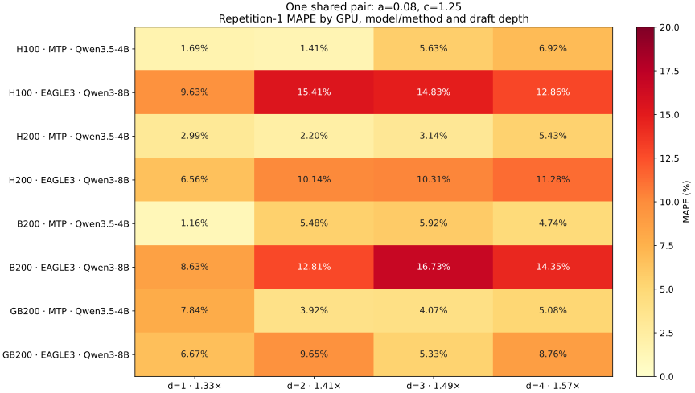

<!--
SPDX-FileCopyrightText: Copyright (c) 2026 NVIDIA CORPORATION & AFFILIATES. All rights reserved.
SPDX-License-Identifier: Apache-2.0
-->

# SD FPM draft-depth calibration (protocol 5)

The two fixed coefficients were compared against protocol-5 measurements of
Qwen3.5-4B native MTP and Qwen3-8B EAGLE3 on H100, H200, B200 and GB200:
TP1 BF16, top-k 1, `d=1/2/3/4`, batch `1/4/8`, initial context `1024/4096`,
two repetitions and 256 generated tokens. The CUDA interval brackets the
model-worker forward call, including possible host launch gaps; it excludes
prefill and scheduler work outside that call. Offload, overlap scheduling and
radix caching were disabled.

The proposed fixed rule has **8.08% round-weighted MAPE**, **7.33%
equal-configuration MAPE**, **18.19% P90 absolute error**, and **31.53%
worst-configuration MAPE** over 18,836 repetition-1 rounds / 192 configurations.
Repetition 0 defines the frozen measured STP reference. These data were already
inspected during the study; they are not a new blind test. Errors exclude
actual FPM prediction error and do not establish accuracy on every supported
model. One model per method confounds model/method effects. Hopper MTP used
FlashInfer, while Blackwell MTP used TRT-LLM MHA; EAGLE3 used FlashInfer on both.
The family comparison includes runtime/backend differences. Depths beyond
1–4, other models and production workloads are extrapolation.

The figure records the study values supplied with this change. Full observations,
exclusions and fitting comparisons are in the
[study report](https://gitlab-pages-72a7bf.gitlab-master-pages.nvidia.com/sd-unified-depth.html)
(NVIDIA access; report revision `19ff8f8a4d6018fe0d2009af1013aae90df882a6`).

## Formula and numerical results

`T_SD,iter = (0.08*d + 1.25) * F_STP((d+1)*B, K_total)`, where `d` is draft
length, `B` is the logical decode batch per rank, and `K_total` is total past
KV. The STP reference is measured/interpolated, not the output of the FPM
implementation being validated. See the [API contract](../../../docs/perf-model/methods/whole-forward.md#estimate-speculative-decode-from-an-stp-fpm).

Repetition-1 round-weighted MAPE, grouped by GPU/model/method/depth:

| GPU | Model / method | d=1 (1.33x) | d=2 (1.41x) | d=3 (1.49x) | d=4 (1.57x) |
| --- | --- | ---: | ---: | ---: | ---: |
| H100 | Qwen3.5-4B / MTP | 1.69% | 1.41% | 5.63% | 6.92% |
| H100 | Qwen3-8B / EAGLE3 | 9.63% | 15.41% | 14.83% | 12.86% |
| H200 | Qwen3.5-4B / MTP | 2.99% | 2.20% | 3.14% | 5.43% |
| H200 | Qwen3-8B / EAGLE3 | 6.56% | 10.14% | 10.31% | 11.28% |
| B200 | Qwen3.5-4B / MTP | 1.16% | 5.48% | 5.92% | 4.74% |
| B200 | Qwen3-8B / EAGLE3 | 8.63% | 12.81% | 16.73% | 14.35% |
| GB200 | Qwen3.5-4B / MTP | 7.84% | 3.92% | 4.07% | 5.08% |
| GB200 | Qwen3-8B / EAGLE3 | 6.67% | 9.65% | 5.33% | 8.76% |

## Evidence scope and provenance

This artifact preserves the study summary and figure in the repository without
requiring NVIDIA access. It does not add new GPU measurements. The linked
internal report contains the full observations and analysis code, frozen at
revision `19ff8f8a4d6018fe0d2009af1013aae90df882a6`; raw timing samples are not
bundled here. The report records these SHA-256 hashes for the uncompressed
input datasets, both named `depth-sampling.json`:

| Campaign | SHA-256 |
| --- | --- |
| Hopper | `1a14ef8e84f816fb4e469eb265976558cf80fe21f502c8133a2362e38eb44171` |
| Blackwell | `c3407a2c1d187e5b87b7d73c120c1e22b2e8541adb7cadcf44f0ee1c3d80f364` |

The two campaigns retain 37,574 rounds across repetitions, including 18,836
validation rounds. Exclusions remove each cell/repetition's first 16 rounds,
batch transitions, non-graph execution and observations outside STP-reference
support; no trimming by prediction error is applied. Prompts are seeded random
tokens and acceptance is natural. These are timing experiments, not model
quality or production-serving acceptance tests. The worst configuration is
GB200 / Qwen3-8B EAGLE3 / d=2 / B=8 / initial context 4096, with 31.53% MAPE.
