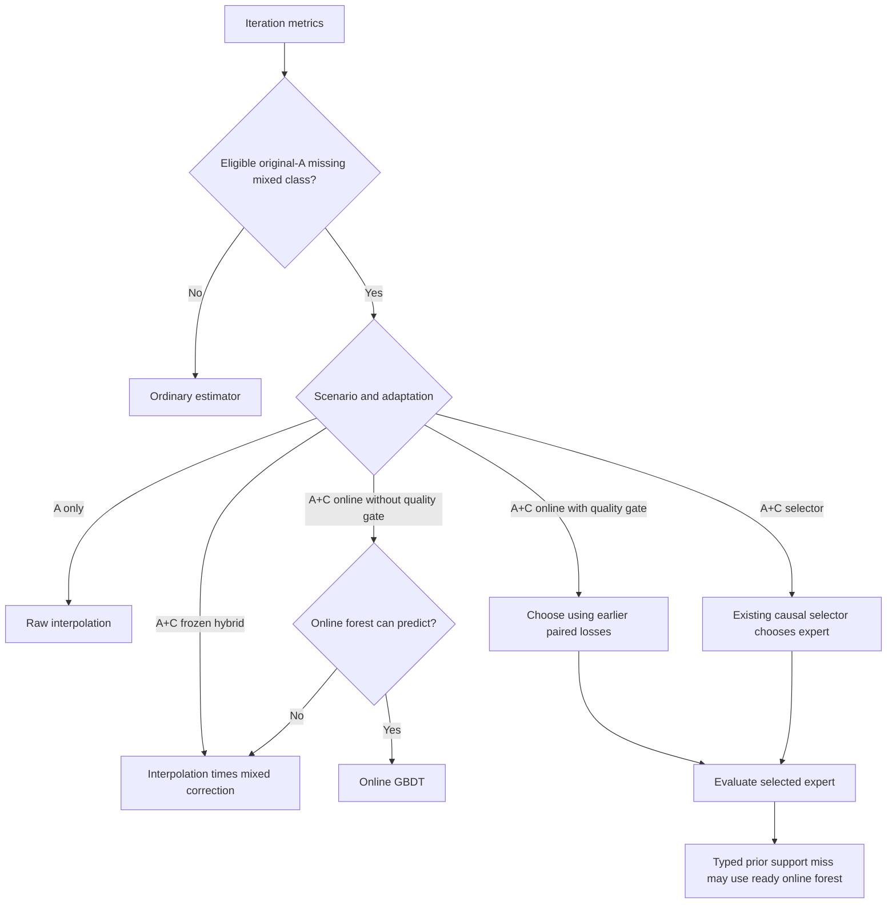

<!--
SPDX-FileCopyrightText: Copyright (c) 2026 NVIDIA CORPORATION & AFFILIATES. All rights reserved.
SPDX-License-Identifier: Apache-2.0
-->

# Mixed-workload fallback for learned forward-pass models

An aggregated worker can encounter a mixture of prefill and decode even when
its original self-benchmark trained only pure-prefill and pure-decode forests.
A learned model normally returns an unavailable estimate for that missing
forest. This optional policy supplies a whole-forward interpolation estimate
for the missing mixed class, calibrates it when feedback is available, and
allows an independently trained online forest to become an expert later.

The policy belongs to the canonical
`ForwardPassPerfModel::best_available(config)` interface, exposed in Python as
`RustForwardPassPerfModel.best_available(config)`. Rust owns eligibility,
interpolation, calibration, routing and feedback admission. The caller owns
chronological feedback sampling and training the first forest of a missing
class. See [configuration](configuration.md#temporary-mixed-composition-for-self-benchmark-seeds)
for field definitions and [online model mathematics](online-gbdt-and-causal-selection.md)
for the ordinary GBDT and selector algorithms.

## Data populations and scope

**A** is the immutable, accepted self-benchmark population used to train the
original seed. **B** is an offline serving-trace training population. **C** is
feedback admitted chronologically during serving or a trace evaluation.
A query must be predicted before its C label updates the model.

The policy requires explicit `estimation_mode: fpm_learned`,
`worker_type: aggregated`, and a verified original-A manifest. It preserves
the learned estimator's existing restrictions, including denial of global
estimator fallback and unsupported speculative execution. Its `scenario`
field accepts only `a` and `a_c`; it does not infer a population from a filename
or from the presence of a frozen forest.

| Available population | Standalone GBDT | Frozen hybrid calibration | Causal selector |
| --- | --- | --- | --- |
| A only | `scenario: a`, `mode: compose`, explicit frozen adaptation. Eligible mixed queries use raw interpolation; no C updates. | With no C labels, there is no learned correction. The same frozen A-only composition can supply the missing class. | The A-only policy rejects selector adaptation; no online comparison is defined by this policy. |
| B only | Ordinary B-trained behavior; this policy is disabled. | Ordinary B-trained behavior; this policy is disabled. | Ordinary behavior; this policy adds no B-based expert or comparison. |
| C only | Existing caller-managed cold start and online fitting; there is no original-A interpolation prior. | Existing cold-start/calibration integration; this policy adds no prior. | Existing cold-start selector integration; this policy adds no prior. |
| A+C | Calibrated interpolation until an online mixed forest is available; optionally keep checking its quality afterward. | Calibrated interpolation for A-missing mixed classes. Original forests stay frozen; C never creates a mixed forest on this path. | Calibrated interpolation is the stable expert; an independent C-trained forest competes through the existing causal selector. |
| B+C | Existing B-seeded adaptation; this policy is disabled. | Existing B-seeded calibration; this policy is disabled. | Existing B-seeded expert selection; this policy is disabled. |

This table describes what the policy changes. It does not promise readiness of
an ordinary B/C model whose own training requirements are unmet. Adding general
cold-start training, collecting feedback, and integrating learned timing into
additional Replay or Planner consumers are separate changes.

## Two independently eligible mixed classes

The native workload classifier distinguishes four forest stores:

- `pure_prefill`: scheduled prefill work without decode.
- `pure_decode`: scheduled decode work without prefill.
- `contains_locally_mixed`: at least one rank schedules both prefill and decode.
- `cross_rank_aggregated`: prefill and decode occur across the group, but only
  on separate pure ranks.

Only the last two stores can use this fallback. The manifest records accepted
original-A groups, the original training threshold `min_store_rows`, and
references to the fitted seed artifacts. Rust recomputes counts and verifies
the artifacts. Enough A groups without a matching trained store is an input
error; it is not permission to hide a broken seed behind interpolation.

Each mixed class is eligible when its verified original A has no usable store.
The eligibility map remains fixed for the instance's lifetime. Appending a
C-trained store changes online readiness, but never rewrites A or changes
eligibility. Pure classes and usable A-trained mixed classes retain their
ordinary estimator, calibration and selector behavior.

To retire the fallback for a class, collect sufficient qualified self-benchmark
data, train a new seed, and construct a new instance with a new manifest. If
neither mixed class is eligible, construction creates no interpolation engine
or mixed calibration stores.

## Source binding and construction

`fpm_learned.write_original_a_manifest(...)` exports the accepted A groups using
the trainer's eligibility rules. It writes exclusively to a new file and returns
the path and SHA-256 for `temporary_mixed_composition.original_a`. It must run
before C data is mixed into the training population.

Construction validates the manifest schema, deployment identity, original
source-file hashes, seed hashes, feature names, target and per-store training
counts. Frozen and selector models must retain the verified original forest
contents. Online continuation binds its immutable training-checkpoint anchor
to original A. Every original-A group must have exactly one metric for each
attention-DP rank, finite nonnegative rank times and a positive group target.
Source hashes identify bytes; a trusted exporter must still establish that the
accepted groups actually came from those bytes.

The interpolation engine is prepared once through the canonical constructor,
using the same deployment and configured FPM interpolation method. Its learned,
selector and ordinary correction controls are cleared because this engine
provides an uncorrected interpolation prior. Construction validates the timing
table and pins its Parquet and metadata hashes. A separately supplied table
must match the deployment identity; the policy does not invent a profile or
switch interpolation methods after a query fails.

## Prediction and interpolation coverage



The prior uses existing whole-forward rank composition. For direct interpolation,
the mixed-rank construction combines prefill and decode timing while removing
the decode-zero baseline already represented in both phases. A synthetic
2 ms prefill, 3 ms decode and 1 ms decode-zero table therefore gives a 4 ms
mixed estimate. The configured method owns its supported coordinates and
analytical alternatives; this policy adds no new latency formula to it.

The fallback requires complete, unique attention-DP rank groups when it actually
needs the prior. Ordinary-first online inference can return an ordinary estimate
without imposing additional fallback rank requirements. Prediction does not
consume the query's `wall_time` or mutate calibration or selection evidence.

`FpmQueryUnsupported` and `InterpolationCoverage` distinguish a supported absence
from malformed data. A typed prior support miss produces an unavailable prior.
A ready online forest can answer instead, including before selector warmup
finishes. This coverage escape does not create a paired comparison or claim
that online has passed the quality test. Source corruption, identity mismatch,
invalid metrics and numerical errors remain errors.

## Independent mixed calibration

For A+C, each eligible mixed class has its own hybrid calibrator. It estimates
`observed_ms / raw_interpolation_ms` and multiplies the raw prior by the resulting
factor. Before the support threshold is met, the factor is one. Calibration
never uses the already corrected prediction as its ratio denominator.

The coordinates are the existing native attention and FFN/MoE workload scores.
For rank `r`, let `P_r` be total prefill tokens, `N_r` prefill requests,
`Kp_r` prefill KV tokens, `D_r` decode requests, and `Kd_r` decode KV tokens.
For a rank with prefill work:

```text
prefill_pairs_r = Kp_r * P_r / N_r + P_r² / (2 * N_r) + P_r / 2
attention_r    = alpha * (Kp_r + Kd_r) + beta * prefill_pairs_r
attention      = max_r attention_r
ffn_moe        = gamma * sum_r(P_r + D_r)
```

Without prefill work, the prefill KV contribution and `prefill_pairs_r` are
zero. These `alpha`, `beta` and `gamma` are the positive feature weights under
`estimator_config.features`; they are unrelated to either selector's EWMA alpha.

The fixed grid's upper bounds are the maxima of these two scores over accepted
original A. The dynamic policy expands bounds in log space from admitted
feedback and combines balanced local samples with a recent global fallback.
Geometry alone selects the hybrid policy: queries inside the original-A fixed
grid use fixed calibration; queries outside it use dynamic calibration. An empty
or unready fixed cell does not redirect an in-grid query to the dynamic policy.
Both policies ingest the raw ratio independently. Optional lower and upper
factor bounds apply at admission.
Mixed fixed-grid eviction uses deterministic ties.

The two mixed classes never share correction histories. Their histories are
also separate from ordinary forest correction. This distinction is essential
for frozen hybrid A+C: C calibrates the missing-class interpolation estimate,
but never trains a new forest or triggers a handoff after 20 labels.

## First online forest and causal feedback

Online GBDT and selector callers may collect at least 20 causally admitted C
observations for one eligible missing mixed class, fit a standard single-class
training checkpoint, and call `append_mixed_learned_checkpoint(path)`. The native
model does not own this initial buffer or invoke the Python trainer.

The append operation validates the complete checkpoint, hashes, identity,
features, target, class eligibility and actual training-row count before
mutation. It rejects duplicate stores, multiple stores, an unrelated class,
runtime checkpoints and frozen adaptation. It adds only the new online forest
and learner state. Existing forests, pending online rows, original-A identity,
calibration and selector histories remain in place.

The query associated with the twentieth training label is predicted before
fitting. Those training labels are not replayed into paired-loss evidence.
Only later feedback for which both experts predicted successfully before the
update can contribute a comparison. For every admitted label:

1. Compute the raw prior and both required pre-update expert predictions.
2. Stage the calibration observation and any paired-loss update.
3. Admit the ordinary online observation, preserving its existing fit schedule.
4. Commit the corresponding calibration and comparison once admission succeeds.

An ordinary fit can fail after accepting a row. Its already admitted calibration
and comparison history is preserved exactly once; `flush_updates()` retries
the pending fit without readmitting labels. A hard prior error can also be
returned after ordinary learning accepted the row. Callers must inspect
admission progress and must not resubmit that label as a new observation.
An unsupported prior contributes neither calibration nor paired loss, while
valid ordinary learning can continue.

## Standalone GBDT quality checker

Without `quality_gate`, A+C online GBDT prefers an available ordinary estimate.
Enabling `quality_gate` retains calibrated interpolation until the online
expert earns selection from subsequent paired feedback. For measured latency
`y_t` and pre-update predictions `i_t` and `g_t`, the losses are fractional APE:

```text
loss_I = abs(i_t / y_t - 1)
loss_G = abs(g_t / y_t - 1)
EWMA_e(1) = loss_e(1)
EWMA_e(t) = (1 - alpha) * EWMA_e(t - 1) + alpha * loss_e(t)
choose online iff comparisons >= min_comparisons and EWMA_G <= EWMA_I
```

The configured defaults are `alpha: 0.05` and `min_comparisons: 5`; setting
`min_comparisons: 1` starts selection after the first future paired label.
Equality favors online. Checking continues after a switch, so the model can
return to interpolation and later re-enter online. Both experts continue
learning while unselected. There is no one-way latch or future-accuracy guarantee.

Evidence is keyed by forest store and the native critical-rank query type
(`prefill`, `decode` or `mixed`). That type is derived from scheduled workload,
not the measured label. A mixed group can have a pure critical rank. Training
readiness is per forest store; comparison readiness is per store/query key.
The implementation uses twelve fixed evidence slots and retains no loss history.

## Selector behavior

For an eligible A+C mixed class, calibrated interpolation replaces the missing
frozen forest as the stable expert. The online expert remains an independent
C-trained forest. The existing causal selector keeps its own EWMA alpha,
warmup, improvement margin and persistence controls. It switches only when the
alternative's EWMA is strictly below `(1 - margin)` times the active expert's
EWMA for the required consecutive comparisons after warmup.

The standalone `quality_gate` is rejected for `causal_selector` and `frozen`
adaptation. There is one selection policy for each mode, without stacking the
new checker on the existing selector. Pure and A-supported mixed classes keep
the ordinary frozen/calibrated-versus-online experts. Normal prediction
evaluates only the selected expert; feedback evaluates both when available.

## Diagnostics, persistence and compatibility

`estimate_forward_pass_with_route(metrics)` returns latency and its actual
mixed route in one dispatch. Route metadata distinguishes immutable
`fallback_eligible` from current `route`/`owned`, and reports the selected and
preferred experts, online readiness, comparison progress and calibration
admissions. Expert availability is null when that expert was not queried.
`mixed_composition_route()` is read-only but may itself evaluate an expert;
calling it after a separate estimate can repeat work.

`mixed_composition_state()` serializes calibration and optional standalone
quality evidence. Restoration validates version, original A, deployment,
interpolation sources, geometry, settings, counters and retained observations
before replacing live state. The format is
`original_a_mixed_experts_attention_moe_v3`. Earlier forced-interpolation and
availability-policy snapshots must be reconstructed from their original
sources and causal admissions.

Standalone `save_online_checkpoint()` includes the mixed state along with the
online learner. An online checkpoint containing mixed state cannot be loaded
as frozen inference or with the mixed policy disabled. Frozen hybrid callers
can save the mixed snapshot explicitly, but must also preserve ordinary
calibration and their admission cursor for a complete continuation.

Portable `save_state_snapshot()` and `estimator_config.state_snapshot` reject
this policy explicitly. Their existing format does not package the extra
interpolation engine, A sources, mixed calibration and appended selector
stores. A portable snapshot must not silently omit them. Ordinary portable
snapshots retain their existing layout and behavior; adding complete portable
mixed-model snapshots is separate work. Full mixed-selector continuation is
not supplied by the partial mixed-state API.

## Cost and validation boundaries

Construction verifies original-A groups and source hashes and prepares one
interpolation engine when needed. This cost grows with the seed population and
timing table, not with the subsequent trace length. Ordinary hot paths retain
their normal predictor. Mixed inference uses one selected expert except for
an explicit availability escape; feedback necessarily evaluates the experts
needed for a causal comparison and reuses the prior query for calibration.

With sample budget `M`, two eligible classes retain at most `4M` calibration
sample slots across independent fixed and dynamic policies. Online forests and
their existing training history have separate budgets. Caller-held bootstrap
rows and temporary checkpoint/training allocations are additional. The twelve
quality evidence slots are fixed-size regardless of trace length.

Regression coverage exercises A eligibility, both mixed classes, complete-rank
validation, hand-derived interpolation, frozen hybrid correction, bootstrap
isolation, pre-update losses, repeated switches, fit failure, coverage escapes,
source mismatch and checkpoint continuation. Existing engine parity and
ordinary portable-snapshot tests protect unaffected behavior.

Prediction coverage is the fraction of eligible observations with a returned
latency. It is separate from accuracy, interpolation qualification and serving
throughput. A coverage gain adds a new scoring population; compare accuracy on
the common population and report error on newly covered mixed observations
separately. A missing prior and an unready online forest can still leave a
query unavailable. Experimental coverage and host-cost results belong with
benchmark evidence and the PR summary, rather than being product guarantees.

## Implementation map

| Responsibility | Source |
| --- | --- |
| Configuration and scope checks | `crates/core/src/perfmodel/fpm/{estimator,config}.rs` |
| A-source validation, prior, geometry and mixed state | `crates/core/src/perfmodel/fpm/mixed_fallback.rs` |
| Canonical dispatch and feedback admission | `crates/core/src/perfmodel/fpm/model.rs` |
| Standalone paired-error checker | `crates/core/src/perfmodel/fpm/quality_gate.rs` |
| Mixed selector integration and existing selection | `crates/core/src/perfmodel/fpm/{combined,selector}.rs` |
| Atomic mixed forest append and online continuation | `crates/core/src/perfmodel/fpm/learned_online/checkpoint.rs` |
| Original-A exporter and Python API | `python/aisimulate/src/aisimulate_core/sdk/{fpm_learned,rust_engine_step}.py` |
