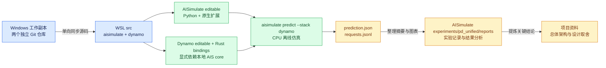
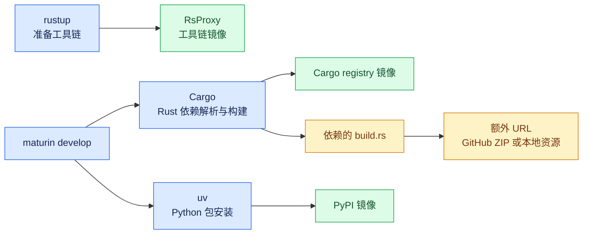

# DynoSim WSL 源码部署与官方基线运行指南

更新日期：2026-10-21；安装命令沿用此前已核对的版本，本次更新文档归属与运行进度。

目标：将现有 Windows 源码同步到 WSL，从本地源码构建 AISimulate 和 Dynamo，再复现官方离线仿真用例。Windows 负责源码编辑与 Git 管理，WSL 的 Linux 文件系统负责执行、依赖和构建缓存。

**2026-10-20 新增：安装完成后，可使用 [DynoSim 静态部署实验入口](../README.md)，直接准备 Mooncake trace 并运行单实例／四 GPU 固定配比对照。脚本、配置和测试统一由 AISimulate 仓库管理，WSL 入口为 `/home/qingya/aisimulate/experiments/pd_unified/run_baseline.py`。该说明包含 PyCharm 配置、分号环境变量、入口参数及结果文件；无需重复构建源码。**

**先完成两个实验：① 本地模型配置、6 个请求的功能验证；② 官方 Qwen3-32B-FP8 性能预测示例。** 第一个实验使用人为指定的固定耗时，第二个实验才使用性能模型估计耗时。

当前部署约定：**在 WSL 中使用 root 操作，源码位于 `/home/qingya`，虚拟环境、构建缓存和实验结果位于 `/home/qingya/pd-sim`。** Rust 工具链及 root 用户级配置保留在 `/root`。

截至本次用户提供的日志，进度如下；后面的安装步骤供复现使用，已完成的步骤无需重做。

| 项目 | 已确认状态 |
|---|---|
| 系统与 Python | Ubuntu 24.04、x86_64、Python 3.12.3 |
| Rust 工具链 | Rust / Cargo 1.96.1 已安装 |
| Python 构建工具 | pip 26.2.1、uv 0.13.1、Maturin 1.15.0、patchelf 0.19.1.0 已安装 |
| 项目安装 | `ai-dynamo-runtime 1.6.0`、`ai-dynamo 1.6.0`、`aisimulate 0.13.0` 均已安装，用户提供的列表显示本地 editable 路径 |
| 依赖与 CLI | `pip check` 通过，`aisimulate predict --help` 正常 |
| 最小功能仿真 | 用户截图确认完成 6 个请求，并保存 `prediction.json`；逐请求文件可按第 4.4 节核验 |
| 性能模型驱动的实验 | 已完成 937 条 Mooncake 请求的四 GPU 静态部署对照，见 [首轮结果分析](../reports/DynoSim_静态部署首轮结果分析.md)；第 5 节的独立官方预测示例没有另行执行记录 |

此前构建中的 FATBIN 和 `dead_code` 信息属于警告，最终已收到 `Installed ai-dynamo-runtime-1.6.0`。第 7 节保留实际遇到的网络问题及可选处理方法；第 11 节提供刚跑通的最小用例代码阅读路线。

## 1 软件组成与安装方式

### 1.1 推理平台与仿真组件

这里的 DynoSim 是 Dynamo 仿真能力的统称，当前入口为 `aisimulate predict --stack dynamo`。

| 组件 | 本次用途 |
|---|---|
| 本地 AISimulate | 构建 `aisimulate._runtime` 原生扩展，Python 部分以 editable 方式安装 |
| 本地 Dynamo Python | 以 editable 方式安装 `ai-dynamo`，提供仿真适配器及 Router、Planner 集成 |
| 本地 Dynamo Rust bindings | 编译 `ai-dynamo-runtime`，提供 `dynamo._core` 原生扩展 |
| 本地 AISimulate Rust core | 同时作为 Dynamo 的本地 Cargo 依赖，确保两套扩展使用同一份仿真核心源码 |

这些离线实验运行在 CPU 上。配置里的 `h200_sxm` 是**被模拟的 GPU 类型**，`backend: vllm` 是被模拟的推理后端。本次无需启动真实 vLLM 服务或下载模型权重。

此版本的 CPU 源码构建可利用 `nixl-sys` 在缺少原生库时的 stub 回退，以及 `cudarc` 的动态加载和无 nvcc 回退。它们允许离线仿真构建，不代表本机具备真实 GPU/NIXL 数据传输能力；也不能简单用顶层 `--no-default-features` 解释为关闭了全部 GPU 相关依赖。相关依赖源码与官方构建流程已核对，实际编译仍需验收。



### 1.2 各构建工具分别负责什么

| 工具或组件 | 主要职责 | 本项目中的位置 |
|---|---|---|
| Dynamo | 真实推理集群的路由、PD 协同和伸缩等编排；提供仿真适配器 | `dynamo` 源码仓库 |
| AISimulate | 模拟 worker、调度与 KV 行为、性能估计、时间推进和配置搜索 | `aisimulate` 源码仓库 |
| rustup | 安装、选择和更新 Rust 工具链 | root 用户的 `/root/.cargo`、`/root/.rustup` |
| Cargo | 解析 Rust 依赖、下载 crate、调用编译器构建 | 读取 `Cargo.toml`、`Cargo.lock` 和 Cargo 配置 |
| rustc | 将 Rust 源码编译成机器代码 | 由 Cargo 调用 |
| Maturin | 构建 Rust → Python 原生扩展并完成开发安装/打包 | 本次使用 `maturin develop --uv --release` |
| pip / uv | 安装 Python 包及依赖；源码包可触发构建后端 | 往当前 venv 安装依赖；Maturin 也会调用 uv |
| venv | 隔离 Python 第三方包和命令入口 | `/home/qingya/pd-sim/.venvs/dynosim-src` |

Maturin 负责 Rust 与 Python 的结合，不替代 Cargo。项目的纯 Python 部分也有自己的打包后端，例如 Dynamo 使用 Hatchling；通常由安装工具自动调用。

`maturin develop` 中，`develop` 指开发安装方式，`--release` 指 Rust 优化构建，两者可以同时使用。依赖解析、Python 依赖安装和 Rust 编译属于不同步骤；看到 `Found CPython` 或 `Found pyo3 bindings` 只说明识别到了环境，不代表编译即将结束。

首次构建需要展开间接依赖：网络、异步运行时、序列化、TLS、日志、路由及性能模型等库会继续依赖其他库。大量 `Downloading` 和 `Compiling` 输出属于正常阶段。后续下载通常复用缓存；编译结果能否复用还取决于版本、features、构建配置和 target 目录。

### 1.3 系统开发依赖的作用

| APT 包 | 用途 |
|---|---|
| `python3-venv` | 创建 Python 虚拟环境；新环境通常自带 pip |
| `python3-dev` | Python 原生扩展所需的开发文件 |
| `build-essential` | GCC、G++、Make 等基础编译工具 |
| `cmake` | 构建部分 C/C++ 依赖 |
| `pkg-config` | 查找系统库的头文件、链接路径和参数 |
| `libclang-dev` | Clang 开发库，供 Rust 绑定生成等工具解析 C/C++ 接口 |
| `protobuf-compiler` | 提供 `protoc`，处理通信接口的 `.proto` 定义 |
| `libhwloc-dev` | CPU、核心和 NUMA 等硬件拓扑相关开发库 |
| `libudev-dev` | Linux 设备信息和设备事件相关开发库 |
| `libssl-dev` | TLS / 加密相关开发库 |
| `git`、`curl`、`rsync`、`ca-certificates` | Git 操作、下载、同步和 HTTPS 证书验证 |

APT 安装系统工具和开发库；venv 隔离 Python 包，二者并不重复。Linux 的 venv 通常通过软链接复用 WSL 内的系统 Python 解释器，并使用独立 `site-packages`。创建环境后还要激活：`source /home/qingya/pd-sim/.venvs/dynosim-src/bin/activate`。

### 1.4 源码、运行环境和缓存的位置

```text
/home/qingya/
├── aisimulate/
├── dynamo/
└── pd-sim/
    ├── .venvs/dynosim-src/
    ├── build/aisimulate/
    ├── build/dynamo/
    ├── downloads/
    └── baseline/
```

| 位置 | 内容与保留方式 |
|---|---|
| 两个源码目录 | 当前 editable 安装依赖这些源码；开发安装生成的扩展也可能放在源码树中 |
| `pd-sim/.venvs/dynosim-src` | 运行环境、第三方 Python 包、入口命令和安装记录，不能当缓存清理 |
| `pd-sim/build` | Cargo 编译缓存及可重建产物；安装验收后通常可以清理，但下次构建会更慢 |
| `pd-sim/downloads` | 预下载的构建资源，例如固定版本 Swagger UI ZIP；配置引用本地文件时应保留 |
| `pd-sim/baseline` | 配置、日志和仿真结果，属于实验资料 |
| `/root/.cargo/registry`、`/root/.cargo/git` | Rust registry 与 Git 依赖的下载缓存 |

`CARGO_TARGET_DIR` 只改变 Cargo 输出目录，不保证所有生成文件都在源码树外。混合项目的 Maturin 开发安装会将原生扩展放入 Python 源码目录；普通第三方依赖通常安装在 venv 内。[Maturin 开发安装说明](https://docs.rs/crate/maturin/1.15.0)

本项目预期扩展位置包括 `dynamo/lib/bindings/python/src/dynamo/_core*.so` 和 `aisimulate/python/aisimulate/src/aisimulate/_runtime*.so`。实际加载位置以第 3.7 节输出的模块 `__file__` 为准，不能仅根据 build 目录存在 `.so` 判断。

## 2 已选定的源码分支与版本

两个仓库的远程都是 NVIDIA 官方仓库：

| 仓库 | 远程名 | URL |
|---|---|---|
| AISimulate | `aisim` | https://github.com/ai-dynamo/aisimulate.git |
| Dynamo | `dynamo` | https://github.com/ai-dynamo/dynamo.git |

选定组合如下：

| 本地仓库 | 分支 | 本次核对的 HEAD |
|---|---|---|
| `仿真工具/aisimulate` | `aisim_v0.13.0` | `221b8163825c2526a9d050a0813d03a538c32e8e` |
| `仿真工具/dynamo` | `dynamo_v1.6.0` | `d94072d69df850d183ce0a98001b0029893f5bb2` |

Dynamo 已从 `0b86c093ae` 快进至上述提交，跟踪官方 `release/1.6.0`。其根目录及 Python bindings 的 Cargo 配置明确固定 AISimulate `221b8163`，与当前本地 AISimulate 完全一致；Python 包版本分别为 `1.6.0`、`0.13.0`，也满足声明的依赖范围。

AISimulate 保留当前 `aisim_v0.13.0`。远程 `release/0.13.0` 已多出 6 个提交，本次不继续更新，以保持与 Dynamo 显式固定的源码一致。后续更新时一起检查两个仓库的依赖关系。

这不是上一版 README 中的预发布 wheel 组合，不能把那组包的验证结果直接算作当前源码已经编译通过。[Dynamo 固定 AIS 源码的配置](https://github.com/ai-dynamo/dynamo/blob/d94072d69df850d183ce0a98001b0029893f5bb2/lib/bindings/python/Cargo.toml)

## 3 在 WSL 中同步与构建

以下全部是 **WSL 内 root 用户的 Bash 命令**。每一步成功后再继续；若当前已经在编译，完成后再核对，不要重复启动同一构建。

### 3.1 检查系统

```bash
cat /etc/os-release
uname -m
python3 --version
```

建议使用 Ubuntu 24.04、Python 3.12；普通 Windows PC 通常显示 `x86_64`。如果现有发行版的默认 Python 不是 3.12，先准备 Python 3.12，再执行后面的 `python3.12 -m venv`，不要直接套用其他版本。

### 3.2 安装源码构建依赖

Ubuntu 24.04 中：

```bash
apt update
apt install -y \
  python3-venv python3-dev \
  build-essential cmake pkg-config libclang-dev protobuf-compiler \
  libhwloc-dev libudev-dev libssl-dev \
  git curl rsync ca-certificates
```

Rust 1.96.1 已由用户安装。新机器复现时，先下载脚本，下载成功后再执行；若 HTTPS 失败，参见第 7.2 节 rustup 镜像。

```bash
curl --proto '=https' --tlsv1.2 --fail --location \
  --connect-timeout 10 --max-time 60 \
  https://sh.rustup.rs -o /tmp/pd-rustup-init.sh
```

```bash
sh /tmp/pd-rustup-init.sh -y --profile minimal --default-toolchain 1.96.1
source /root/.cargo/env
export RUSTUP_TOOLCHAIN=1.96.1
rustc --version
cargo --version
```

`1.96.1` 来自选定 Dynamo 源码的 `rust-toolchain.toml`。使用 session 变量指定工具链，两个项目统一使用该版本。

### 3.3 同步两个完整源码目录

当前源码已经放在 `/home/qingya/aisimulate` 和 `/home/qingya/dynamo`，无需再复制到其他目录。以下是后续从 Windows 增量同步时可使用的命令：

```bash
export PD_SRC=/home/qingya
WIN_TOOLS='/mnt/c/projects/PD一体化无状态推理/仿真工具'
mkdir -p "$PD_SRC/aisimulate" "$PD_SRC/dynamo" /home/qingya/pd-sim/baseline

for repo in aisimulate dynamo; do
  rsync -rlt \
    --exclude='.git/' --exclude='.idea/' --exclude='.venv/' \
    --exclude='target/' --exclude='dist/' --exclude='wheelhouse/' \
    --exclude='__pycache__/' --exclude='.pytest_cache/' \
    "$WIN_TOOLS/$repo/" "$PD_SRC/$repo/"
done
```

`.cargo`、Cargo manifests/locks 和性能数据必须同步；不要只复制 Python 子目录。`.git` 可以排除：AISimulate 使用固定包版本，Dynamo 的构建钩子在没有 Git 元数据时也能构建，只是不附加源码 SHA。

后续继续从 Windows 同步到相同的 WSL 目录。上述命令不删除目标文件；如果源码删除或改名，需要同时处理 WSL 旧文件，避免旧模块残留。

### 3.4 创建源码开发环境

```bash
mkdir -p /home/qingya/pd-sim/.venvs /home/qingya/pd-sim/build /home/qingya/pd-sim/baseline
python3.12 -m venv /home/qingya/pd-sim/.venvs/dynosim-src
source /home/qingya/pd-sim/.venvs/dynosim-src/bin/activate

python -m pip install --upgrade pip
python -m pip install uv 'maturin[patchelf]>=1.12,<2'

source /root/.cargo/env
export PD_SRC=/home/qingya
export RUSTUP_TOOLCHAIN=1.96.1
export CARGO_BUILD_JOBS=2
```

`CARGO_BUILD_JOBS=2` 是初次编译的保守并行度，可按 WSL 内存调大。Rust 编译缓存可能超过 10 GB，统一留在 WSL 的 `/home/qingya/pd-sim/build`。root 用户的 `~` 是 `/root`，因此项目工作目录不再写成 `~/pd-sim`。

### 3.5 构建 Dynamo 原生运行时并绑定本地 AIS core

先在 Dynamo 仓库的 `.cargo/config.toml` 中保留原有内容，加入以下配置。若已有同名段落，将条目合并到该段，不要重复添加段落。按 Windows 源码为准的约定，可先修改 Windows 的 `仿真工具/dynamo/.cargo/config.toml`，再同步到 WSL 的 `/home/qingya/dynamo/.cargo/config.toml`。

```toml
[patch.crates-io]
aisimulate-core = { path = "../aisimulate/crates/core" }
```

该相对路径以 Dynamo 仓库根目录为基准，指向旁边的 AISimulate。本地配置必须在依赖解析和编译两个阶段都生效。

**Maturin 1.15.0 的兼容细节：** 命令行 `--config` 会传给后面的 Rust 编译，但其前期 `cargo metadata` 参数构造没有转发该字段。因此，只在 Maturin 命令行指定本地 patch，前期仍可能出现 `Updating git repository https://github.com/ai-dynamo/aisimulate.git`。采用上述自动读取的 Cargo 配置，替代旧版指南中的单次 `--config` 参数。[对应源码](https://github.com/PyO3/maturin/blob/v1.15.0/src/cargo_options.rs#L130-L219)

```bash
cd "$PD_SRC/dynamo"
set -o pipefail
CARGO_TARGET_DIR=/home/qingya/pd-sim/build/dynamo \
maturin develop --uv --release \
  --features ais-forward-pass \
  --manifest-path lib/bindings/python/Cargo.toml \
  2>&1 | tee /home/qingya/pd-sim/baseline/build-dynamo.log
```

这里需要保留两项：

- `ais-forward-pass`：启用原生 AIS 性能模型桥。只跑 fixed timing 可能发现不了缺失；第二个性能模型示例需要它。
- 项目 `.cargo/config.toml` 中的本地 patch：将 Dynamo 默认从 Git 固定提交获取的 AIS core，替换为这份本地源码。否则 Python editable 生效了，本地 Rust 改动却不会进入 Dynamo。

Cargo 的配置级 patch 优先于 manifest 中同名依赖的 patch。首次由 Git 依赖切换为本地 path 时，不加 `--locked`，因为 WSL 副本中的锁文件会相应改变；该构建产生的锁文件无需反向覆盖 Windows 上游基线。[Cargo patch 优先级](https://doc.rust-lang.org/cargo/reference/config.html#patch)、[Maturin develop](https://www.maturin.rs/local_development)

`CARGO_TARGET_DIR` 指定本次构建缓存位置；`2>&1 | tee` 同时保存普通输出和错误输出；`set -o pipefail` 使管道退出状态能够反映编译失败。示例中的日志文件每次重跑会覆盖，要保留多次记录时先换日志文件名。

### 3.6 安装两个项目的本地 Python 源码

```bash
CARGO_TARGET_DIR=/home/qingya/pd-sim/build/aisimulate \
uv pip install \
  -e "$PD_SRC/aisimulate/python/aisimulate" \
  -e "$PD_SRC/dynamo"

python -m pip check
aisimulate predict --help
```

这一步还会构建 AISimulate 自己的原生扩展。最终有两个 Python 扩展模块：`aisimulate._runtime` 和 `dynamo._core`；它们分别构建，但使用同一份本地 AIS core。

离线仿真先安装上述基础包，不加 `[vllm]`、`[sglang]` 等真实推理后端 extra，也无需安装 GPU Memory Service。

### 3.7 验证安装来源与 Rust 依赖来源

先检查 Python 包确实是 editable 本地安装，并输出扩展路径：

```bash
python - <<'PY'
import importlib
import json
import os
from importlib.metadata import distribution
from pathlib import Path
from urllib.parse import unquote, urlparse

src = Path(os.environ['PD_SRC']).resolve()
for name, expected in (
    ('aisimulate', src / 'aisimulate/python/aisimulate'),
    ('ai-dynamo', src / 'dynamo'),
):
    dist = distribution(name)
    origin = json.loads(dist.read_text('direct_url.json') or '{}')
    assert origin.get('dir_info', {}).get('editable') is True, origin
    actual = Path(unquote(urlparse(origin['url']).path)).resolve()
    assert actual == expected.resolve(), (actual, expected)
    print(name, dist.version, actual)

for name in ('aisimulate._runtime', 'dynamo._core', 'dynamo.replay.simulation'):
    print(name, importlib.import_module(name).__file__)
print('ai-dynamo-runtime', distribution('ai-dynamo-runtime').version)
PY
```

再核对 Dynamo 实际解析的 Rust 依赖，不能只检查 Python 包位置：

```bash
cd "$PD_SRC/dynamo"
cargo metadata --format-version 1 \
  --features ais-forward-pass \
  --manifest-path lib/bindings/python/Cargo.toml \
  > /home/qingya/pd-sim/baseline/dynamo-cargo-metadata.json

python - <<'PY'
import json
import os
from pathlib import Path

data = json.loads(Path('/home/qingya/pd-sim/baseline/dynamo-cargo-metadata.json').read_text())
packages = [p for p in data['packages'] if p['name'] == 'aisimulate-core']
assert len(packages) == 1, packages
pkg = packages[0]
expected = Path(os.environ['PD_SRC']) / 'aisimulate/crates/core/Cargo.toml'
assert pkg['source'] is None, pkg
assert Path(pkg['manifest_path']).resolve() == expected.resolve(), pkg
print('PASS: Dynamo uses local AIS core:', pkg['manifest_path'])
PY
```

不要给 `cargo metadata` 加 `--no-deps`，否则不会列出这里需要检查的传递依赖。

保存依赖清单：

```bash
cd /home/qingya/pd-sim/baseline
python -m pip freeze > environment-freeze.txt
```

新开 root 终端时，恢复环境：

```bash
source /home/qingya/pd-sim/.venvs/dynosim-src/bin/activate
source /root/.cargo/env
export PD_SRC=/home/qingya
export RUSTUP_TOOLCHAIN=1.96.1
export CARGO_BUILD_JOBS=2
```

首次安装需要访问 Python 软件源、Rust 软件源、crates.io、部分 Git 仓库，以及依赖构建脚本使用的额外下载地址；这些渠道的镜像配置相互独立，见第 7 节。

## 4 实验一 官方最小功能验证

### 4.1 使用同步后的完整源码中的示例

使用已同步的 Dynamo 仓库中的 E2E 测试用例，不再单独复制一份测试配置：

```bash
export PD_SRC=/home/qingya
PD_FIXTURES="$PD_SRC/dynamo/components/src/dynamo/replay/tests/e2e/configs/unified_cli"
```

需要用到的两个文件：

```text
components/src/dynamo/replay/tests/e2e/configs/unified_cli/
├── predict/dynamo/01-synthetic-no-adapters.yaml
└── fixtures/tiny-model/config.json
```

这两个文件随上述固定源码版本维护，保留上游测试逻辑。

### 4.2 这个实验模拟什么

| 设置 | 官方测试用例的值 |
|---|---|
| 部署方式 | Aggregated，同一 worker 处理 Prefill 和 Decode |
| 实例数与并行 | 1 worker，TP=1、PP=1 |
| 请求 | 合成输入 32 tokens、输出 4 tokens |
| 负载 | 并发 2，共 6 个请求 |
| KV Cache | block size=64，固定容量 256 blocks，启用 prefix caching |
| 计算耗时 | `timing.type: fixed`，Prefill/Decode 配置值均为 1 ms |
| 模型 | 本地 `tiny-model/config.json`，仅模型结构元数据 |

这是验证软件链路的用例。**1 ms 是输入参数，不是 H200 的实测性能；启用 prefix caching 也不等于这个微型负载验证了缓存复用收益。** Aggregated 是普通合设模式，也尚不代表我们设想的集群动态 PD 角色切换。

来源：[固定版本的官方 YAML](https://github.com/ai-dynamo/dynamo/blob/d94072d69df850d183ce0a98001b0029893f5bb2/components/src/dynamo/replay/tests/e2e/configs/unified_cli/predict/dynamo/01-synthetic-no-adapters.yaml)、[本地模型配置](https://github.com/ai-dynamo/dynamo/blob/d94072d69df850d183ce0a98001b0029893f5bb2/components/src/dynamo/replay/tests/e2e/configs/unified_cli/fixtures/tiny-model/config.json)。

### 4.3 运行

```bash
cd /home/qingya/pd-sim/baseline
PD_FIXTURES="$PD_SRC/dynamo/components/src/dynamo/replay/tests/e2e/configs/unified_cli"

HF_HUB_OFFLINE=1 TRANSFORMERS_OFFLINE=1 \
aisimulate predict \
  --stack dynamo \
  --config "$PD_FIXTURES/predict/dynamo/01-synthetic-no-adapters.yaml" \
  --set "engine.model=$PD_FIXTURES/fixtures/tiny-model" \
  --capture-per-request \
  --output-dir ./results/smoke
```

`engine.model` 覆盖是必要的：上游 YAML 中模型路径以 Dynamo 仓库根目录为起点；这里在独立的 baseline 工作目录运行，用绝对路径指向模型配置。CLI 不会自动将该路径改为相对于 YAML 文件。

两个 offline 环境变量仅作用于这次命令，确保这个使用本地元数据的实验不依赖 Hugging Face 网络。

### 4.4 验收

应产生：

```text
results/smoke/
├── prediction.json
└── requests.jsonl
```

检查完成数与逐请求输出：

```bash
python - <<'PY'
import json
from pathlib import Path

root = Path('results/smoke')
report = json.loads((root / 'prediction.json').read_text())
summary = report.get('summary', report)
requests = [json.loads(line) for line in
            (root / 'requests.jsonl').read_text().splitlines() if line.strip()]

assert summary['completed_requests'] == 6, summary
assert len(requests) == 6, len(requests)
print('PASS: 6 requests completed; 6 per-request records saved')
for key in ('num_requests', 'completed_requests', 'mean_ttft_ms',
            'mean_tpot_ms', 'output_throughput_tok_s',
            'request_throughput_rps', 'duration_ms', 'wall_time_ms'):
    if key in summary:
        print(f'{key}: {summary[key]}')
PY
```

重复运行时，换用新的 `--output-dir`，例如 `./results/smoke-02`。确认旧结果可以替换时才使用 `--overwrite`。

### 4.5 已观察的最小用例结果

用户提供的运行截图显示：完成请求数 6、TTFT 1 ms、ITL 1 ms、请求延迟 4 ms、输出吞吐 2000 token/s、请求吞吐 500 request/s、prefix 复用率 0。它们与本用例的固定耗时和并发参数一致，不能作为真实 H200 性能数据。

总吞吐和总请求数是汇总标量，表格的 min/max/p99 等列由实现填为 `N/A`。功耗和覆盖率缺少数据时输出通用的 `energy provider or topology unsupported`；该提示不能用来诊断用户硬件不支持。`Timing (runner): unavailable` 表示当前 Dynamo 适配器没有返回计时来源元数据，不表示虚拟时间或延迟计算失败。

## 5 实验二 官方模型性能预测

实验一通过后，再执行 AISimulate README 的最小模型预测配置。该实验可能联网读取公开模型的配置元数据，**无需下载 Qwen3-32B 的模型权重**。不要沿用上一条命令中的 offline 环境变量。

为保持 Windows 为准，在 Windows 的以下位置新建 `prediction.yaml`：

```text
C:\projects\PD一体化无状态推理\仿真工具\aisimulate\experiments\pd_unified\prediction.yaml
```

内容与官方 README 的最小预测配置相同：

```yaml
engine:
  mode: aggregated
  model: Qwen/Qwen3-32B-FP8
  hardware: h200_sxm
  backend: vllm
  workers:
    aggregated: {}
```

同步并运行：

```bash
cd /home/qingya/pd-sim/baseline
mkdir -p cases
rsync -rt \
  '/mnt/c/projects/PD一体化无状态推理/仿真工具/aisimulate/experiments/pd_unified/' \
  ./cases/

aisimulate predict \
  --stack dynamo \
  --config ./cases/prediction.yaml \
  --capture-per-request \
  --output-dir ./results/qwen-official
```

该配置采用默认 workload；首轮保留这些默认设置，作为官方示例的对照。后续再显式固定请求数量、输入输出长度、并发、后端版本和随机种子，形成我们的实验矩阵。

不要将实验一的 `fixed` timing 搬到这里。此处让性能模型估计计算耗时；它输出的是指定模型、硬件和后端条件下的预测，后续还需针对目标硬件校准。

两个首轮用例都不添加顶层 `planner` 配置。官方说明 Planner 需要与 Dynamo 版本匹配的额外依赖，等基础运行正常后再接入。[官方预测示例与 Planner 说明](https://github.com/ai-dynamo/aisimulate#predict-one-deployment)

## 6 怎样理解输出和保存基线

`--stack dynamo` 的完整报告在 `prediction.json`，指标一般位于其中的 `summary`；逐请求记录由 `--capture-per-request` 导出到 `requests.jsonl`。只看到 `--help` 成功还不足以说明仿真适配器正常。

| 指标 | 用途 |
|---|---|
| `num_requests`、`completed_requests` | 先确认请求是否完成，避免只看成功子集的延迟 |
| `mean_ttft_ms` | 首 token 延迟，包含所建模的等待和处理时间 |
| `mean_tpot_ms` | 请求内平均生成 token 间隔，再按报告定义汇总 |
| `output_throughput_tok_s` | 模拟时间内的输出 token 吞吐 |
| `request_throughput_rps` | 模拟时间内的完成请求吞吐 |
| `duration_ms` | 被模拟过程的时间跨度 |
| `wall_time_ms` | 仿真程序在当前电脑上的实际执行耗时 |

**不要把 WSL 执行程序的墙钟耗时当成被模拟集群的 TTFT/TPOT。** 指标缺失时保留缺失状态，不填成零；ITL 与 TPOT 也应按各自样本定义比较。[官方指标解释](https://github.com/ai-dynamo/aisimulate/blob/main/docs/getting-started/understand-results.md)

保存两仓的 Windows Git SHA 与实际代码改动、原始 YAML、CLI 覆盖参数、依赖清单、编译日志和 JSON 结果。首次成功后，可以将结果复制回 Windows：

```bash
cd /home/qingya/pd-sim/baseline
WIN_RUN='/mnt/c/projects/PD一体化无状态推理/仿真工具/aisimulate/experiments/pd_unified/results/official-baseline'
mkdir -p "$WIN_RUN"
rsync -rt ./results/ "$WIN_RUN/results/"
rsync -rt ./environment-freeze.txt "$WIN_RUN/"
rsync -rt ./dynamo-cargo-metadata.json "$WIN_RUN/"
```

完整运行输出保留在上述 `results/` 或现有 `仿真工具/tmp_logs`；可版本管理的分析报告、图表和精简摘要维护在 `experiments/pd_unified/reports/`。总体架构稿引用其中的关键结论。

当前状态：第一个功能用例已由用户运行，截图结果见第 4.5 节；之后已完成性能模型驱动的 Mooncake 静态部署对照，见 [首轮结果分析](../reports/DynoSim_静态部署首轮结果分析.md)。第 5 节的独立官方预测示例没有另行执行记录。

## 7 下载渠道、镜像源与网络故障

### 7.1 下载渠道总览

镜像配置按工具生效，不存在一个开关替换所有下载地址。以下均按 root 用户说明；用户级配置影响 root 下使用相应工具的其他项目，项目配置、环境变量和命令行参数还可能覆盖它们。

| 渠道 | 下载内容 | 配置位置或方式 | 当前是否需要 |
|---|---|---|---|
| rustup | Rust 编译器、Cargo、标准库和 rustup 自身 | `RUSTUP_DIST_SERVER`、`RUSTUP_UPDATE_ROOT`；可写入 `/root/.bashrc` | 已用 RsProxy 安装成功；以后下载工具链时沿用 |
| Cargo registry | crates.io 的包索引和 Rust crate | `/root/.cargo/config.toml` 的 `[source.*]` | 下载失败时可使用 RsProxy sparse 镜像 |
| pip | Python 包 | `python -m pip config --user ...`；通常保存于 `/root/.config/pip/pip.conf` | 可配置清华 PyPI 镜像 |
| uv | Python 包，包括 Maturin 调用 uv 时的依赖 | `/root/.config/uv/uv.toml` 或 `UV_DEFAULT_INDEX` | 与 pip 分别配置 |
| APT | Ubuntu 系统包和开发库 | Ubuntu 24.04 通常为 `/etc/apt/sources.list.d/ubuntu.sources` | 之前安装正常则保持现状 |
| Git / curl / 构建脚本直链 | Git 仓库、ZIP 和任意远程资源 | 对应工具的网络/代理配置，或依赖支持的资源覆盖参数 | 包镜像通常不覆盖，需要逐项处理 |
| Go | Go 模块及相关工具链下载 | 模块下载主要由 `GOPROXY` 等控制 | 当前 Python/Rust 仿真构建不需要配置 |



这些是下载源配置，不是覆盖所有 HTTPS 流量的网络代理。不同域名反复出现 TLS EOF，说明网络或代理链路仍可能不稳定；不能因为某个镜像成功，就断定所有下载渠道已恢复。

### 7.2 rustup 镜像

当前终端使用：

```bash
export RUSTUP_DIST_SERVER="https://rsproxy.cn"
export RUSTUP_UPDATE_ROOT="https://rsproxy.cn/rustup"
```

长期使用时，将这两行加入 `/root/.bashrc`，已有相同设置则更新原条目。前者控制工具链资源，后者控制 rustup 安装器和更新资源。它们不配置 Cargo crate 下载源。[rustup 环境变量](https://rust-lang.github.io/rustup/environment-variables.html)、[RsProxy 说明](https://rsproxy.cn/)

本次安装曾在 `sh.rustup.rs` 和 `static.rust-lang.org` 遇到 TLS 错误。前者提供引导脚本，后者提供安装器和工具链，是不同下载阶段。引导脚本已经下载成功时，可按以下方式仅为本次安装指定镜像：

```bash
RUSTUP_DIST_SERVER=https://rsproxy.cn \
RUSTUP_UPDATE_ROOT=https://rsproxy.cn/rustup \
sh /tmp/pd-rustup-init.sh \
  -y --profile minimal --default-toolchain 1.96.1
```

该命令已由用户执行成功。当前无需重新安装 Rust。

### 7.3 Cargo registry 镜像

编辑 `/root/.cargo/config.toml`；文件不存在时新建，存在时保留原有内容，将同名配置段合并：

```toml
[source.crates-io]
replace-with = "rsproxy-sparse"

[source.rsproxy-sparse]
registry = "sparse+https://rsproxy.cn/index/"
```

末尾的 `/` 要保留。后续 registry 解析通常会显示 `Updating rsproxy-sparse index` 一类信息；具体打印格式随 Cargo 版本变化。[Cargo source replacement](https://doc.rust-lang.org/cargo/reference/source-replacement.html)

该设置与项目中的本地 AIS patch 分工不同，两者可以共存：

- `/root/.cargo/config.toml` 的 `[source.crates-io]`：指定 registry 下载渠道。
- `/home/qingya/dynamo/.cargo/config.toml` 的 `[patch.crates-io]`：指定 AISimulate 使用本地源码。

registry 镜像不会自动替换 Git 依赖地址，也不会替换依赖构建脚本中的任意 `curl` URL。

### 7.4 pip 与 uv 的 Python 包镜像

#### pip 用户配置

在激活的虚拟环境中执行：

```bash
python -m pip config --user set global.index-url \
  https://mirrors.tuna.tsinghua.edu.cn/pypi/web/simple

python -m pip config get global.index-url
```

`--user` 指 root 的用户配置，不是 `pip install --user`。项目包仍安装到当前 venv；不要把配置作用域和包安装位置混淆。

#### uv 用户配置

uv 有自己的配置入口，不能只设置 pip 就假定 uv 也会使用同一镜像。

```bash
mkdir -p /root/.config/uv
```

编辑 `/root/.config/uv/uv.toml`，保留既有配置，新增或合并这一条默认索引：

```toml
[[index]]
name = "tuna"
url = "https://mirrors.tuna.tsinghua.edu.cn/pypi/web/simple/"
default = true
```

临时只在当前终端指定时，也可以使用：

```bash
export UV_DEFAULT_INDEX="https://mirrors.tuna.tsinghua.edu.cn/pypi/web/simple/"
```

环境变量会被 Maturin 调用的 uv 子进程继承，并优先于对应的配置文件设置。若结果仍不符合预期，检查项目和环境中的额外 index 设置；配置默认源并不保证任意显式 URL 依赖也被重写。[清华 pip / uv 配置说明](https://mirror.tuna.tsinghua.edu.cn/help/pypi/)、[uv 环境变量](https://docs.astral.sh/uv/reference/environment/#uv_default_index)

本次曾出现 `files.pythonhosted.org/.../pydantic-2.13.5...whl.metadata` 的 `tls handshake eof`，随后 Maturin 报 `uv pip install ... exit status: 2`。这是 Python 包下载失败，处理该渠道即可；它不是 Rust 编译器发现的源码错误。

### 7.5 APT 与 Go 的处理范围

**APT：当前已能安装依赖时无需更改。** 若以后 APT 下载缓慢，在 Ubuntu 24.04 的 `/etc/apt/sources.list.d/ubuntu.sources` 中按镜像说明调整普通仓库的 `URIs`。先备份文件，保留 `noble`、`noble-updates` 等版本信息、`Components` 和 `Signed-By`；不直接套用其他 Ubuntu 版本的示例，安全更新源也保留其独立配置。修改后执行 `apt update` 检查。[Ubuntu 镜像说明](https://mirrors.tuna.tsinghua.edu.cn/help/ubuntu/)

**Go：当前不需要安装或配置。** 本文只构建仿真需要的 Python/Rust 部分。以后构建 Dynamo Kubernetes Operator 等 Go 组件时，再检查 `GOPROXY` 等模块下载设置；Go 模块代理同样不是通用 GitHub 下载代理。[Go 模块环境变量](https://go.dev/ref/mod#environment-variables)

### 7.6 Swagger UI ZIP 的独立下载与本地替代

本次已遇到的失败链路：

```text
Cargo 获取 utoipa-swagger-ui 9.0.2 crate
  → 执行该 crate 的 build.rs
  → curl 下载 GitHub 上的 Swagger UI v5.17.14 ZIP
  → TLS 失败使 build-script-build 退出，Cargo 最终报 101
```

这种额外资源下载不受 Cargo registry 镜像控制。用户重新运行后已继续出现后续编译输出；若当前构建正常推进，先等待结果。只有该下载再次失败时，才需要下面的本地 ZIP 方案。

#### 单独下载同版本资源

```bash
mkdir -p /home/qingya/pd-sim/downloads

curl --fail --location \
  --connect-timeout 10 --max-time 120 \
  'https://codeload.github.com/swagger-api/swagger-ui/zip/refs/tags/v5.17.14' \
  -o /home/qingya/pd-sim/downloads/swagger-ui-v5.17.14.zip
```

该 codeload URL 是[原始官方 ZIP 地址](https://github.com/swagger-api/swagger-ui/archive/refs/tags/v5.17.14.zip)的重定向目标，不保证当前 WSL 网络可访问。若 WSL 仍失败，可以在能访问 GitHub 的 Windows 浏览器下载，再将 ZIP 复制到上述 WSL 路径。

保留 `v5.17.14` 版本及原始 ZIP 结构，不必解压。下载成功后检查 ZIP 完整性及构建需要的文件：

```bash
python - <<'PY'
from zipfile import ZipFile

path = '/home/qingya/pd-sim/downloads/swagger-ui-v5.17.14.zip'
with ZipFile(path) as archive:
    assert archive.testzip() is None, 'ZIP CRC check failed'
    assert 'swagger-ui-5.17.14/dist/swagger-initializer.js' in archive.namelist()
print('PASS: Swagger UI ZIP structure and CRC checked')
PY
```

这是完整性和结构检查，不是独立的来源认证；资源应使用上面的官方地址获取。

#### 让构建脚本读取本地 ZIP

在接下来运行 Maturin 的同一个终端执行：

```bash
export SWAGGER_UI_DOWNLOAD_URL='file:///home/qingya/pd-sim/downloads/swagger-ui-v5.17.14.zip'
```

然后重跑第 3.5 节构建命令。`utoipa-swagger-ui 9.0.2` 支持 `file://`，本地文件分支会复制 ZIP 到 `OUT_DIR`，日志会出现 `start copy to`；不需要修改依赖版本、仿真代码或安装 Node/npm。[9.0.2 构建脚本](https://docs.rs/crate/utoipa-swagger-ui/9.0.2/source/build.rs)

`SWAGGER_UI_OVERWRITE_FOLDER` 是获取、解压资源后的页面覆盖选项，不是这个下载失败的替代方案。也无需仅为解决 TLS 问题切换到其他 Swagger UI 版本。

### 7.7 如何判断是在下载、编译还是已经失败

| 输出 | 含义与下一步 |
|---|---|
| `Updating ... index` | 正在获取包索引，不是在更新用户源码分支 |
| `Updating git repository ...` | Cargo 获取 Git 依赖缓存；若目标是本地 AIS，检查第 3.5 节的配置是否生效 |
| `Downloading` / `Downloaded` | 下载依赖，已有下载通常可以缓存复用 |
| `Found CPython` / `Found pyo3 bindings` | 识别到了解释器和绑定模式，不能据此估计整体完成比例 |
| `Compiling ...` | 正在编译；并行任务的打印顺序不是整体进度百分比 |
| `Found FATBIN ... copied to OUT_DIR` | 找到并复制了内置资源；该行本身不是错误 |
| `function ... is never used` / `dead_code` | 未使用代码警告；本次日志没有将其升级为错误 |
| `spurious network error ... tries remaining` | 正在自动重试；后续成功就可以继续 |
| `error: failed to run custom build command` | 需要查看该依赖 build.rs 的 stderr；可能是下载问题，也可能是编译或工具问题 |
| `build failed, waiting for other jobs to finish` | 已经存在失败，Cargo 等待其他并行任务结束；不能当作成功 |
| `Finished release ...` 及安装完成信息 | 才进入本阶段完成验收，随后仍需检查安装来源并运行最小用例 |

没有持续输出既可能是编译/链接，也可能是等待网络，不能只按静默时长判断卡死。发生失败时保留第一个具体错误及其上下文，日志末尾的 `maturin failed` 通常只是汇总。下载失败无需通过删除编译缓存或更新项目源码来处理。

## 8 其他常见问题

| 现象 | 优先处理 |
|---|---|
| `No matching distribution found` | 核对 Python 3.12 和出错的依赖名；确认运行时已经从本地构建，AISimulate 与 Dynamo Python 包使用 `-e` 同时声明本地来源 |
| 首次编译大量 Rust、耗时较长 | 这是源码部署的正常步骤；保留 WSL 构建缓存，避免每次清空 |
| 找不到 `protoc`、`libclang` 或系统链接库 | 补齐第 3.2 节的系统依赖 |
| 报 `AIS perf model requires the ais-forward-pass feature` | 用第 3.5 节完整命令重建 Dynamo bindings |
| 修改 AIS Rust 后结果没有变化 | 检查 Cargo metadata 中的本地 path，并重建两个原生扩展 |
| NIXL 原生库缺失导致构建失败 | 该版本允许 stub 回退；检查是否设置了禁止回退的 `NIXL_NO_STUBS_FALLBACK=1`，并保留具体编译日志 |
| `pip check` 报冲突 | 检查是否在独立环境，恢复完整版本组合；不要用 `--no-deps` 掩盖冲突 |
| `unknown stack dynamo` 或适配器导入错误 | 检查 `ai-dynamo` 的实际版本、当前 Python、CLI 路径及 `pip check` |
| tiny-model 不存在或误尝试访问 HF | 检查同步目录及 `--set engine.model=...`，确保 `config.json` 位于该模型目录 |
| Qwen 示例无法下载配置 | 检查 WSL 对 Hugging Face 的访问；这是模型元数据获取问题，先保留已通过的本地 fixed smoke 结果 |
| Planner 缺少依赖 | 首轮用例不要带 `planner` 节；之后按对应版本的官方 Planner 指引安装 |
| 输出目录已存在 | 为本次运行选新目录；需要替换时显式使用 `--overwrite` |

## 9 修改源码后的同步与重建

本节是后续开发备忘。当前工作仅为跑通社区基线；团队明确 PD 一体化架构与待验证假设后，再修改仿真器实现。

先运行第 3.3 节的同步命令，然后根据改动位置处理：

| 改动 | 需要的操作 |
|---|---|
| AISimulate 或 Dynamo 的普通 Python 文件 | editable 安装下，新启动的进程读取同步后的源码 |
| AISimulate 的 Rust 文件 | 重建 AISimulate 扩展，并重建 Dynamo bindings；两边都嵌入了 AIS core |
| Dynamo 的 Rust 文件 | 重跑第 3.5 节，始终保留本地 Cargo patch 与 `ais-forward-pass` |
| Python 依赖、构建配置或包结构 | 重新执行本地 editable 安装、`pip check` 和最小用例 |

AISimulate Rust 改动后，显式重装以触发原生扩展重编译：

```bash
CARGO_TARGET_DIR=/home/qingya/pd-sim/build/aisimulate \
uv pip install --reinstall-package aisimulate \
  -e "$PD_SRC/aisimulate/python/aisimulate"
```

随后重跑第 3.5 节的 Dynamo bindings 构建，最后重跑 6 请求用例。Python editable 不会自动重编译 Rust。

首次成功后保留该次源码 SHA、修改内容、配置与结果；后续实验修改继续在 Windows 的各自 Git 仓库维护。

## 10 基线之后怎样接到 PD 一体化研究

按以下顺序逐步增加能力，每一步保留可对照的结果：

1. **普通合设基线**：用模型性能估计，固定负载、并行方式、KV 容量与调度配置。
2. **官方 PD 分离基线**：启用固定 P/D worker 配比、KV transfer 模型，研究传输成本对 TTFT/TPOT 的影响。
3. **路由与负载变化**：逐项引入 prefix 复用、KV 感知路由和负载变化，再判断是否需要 Planner。
4. **我们的扩展**：加入实例角色切换成本、统一状态索引开销、Segment 池拓扑、多介质队列与带宽争用、稀疏召回及优先级控制。

第 4 步包含新的建模工作，不能把现有 KV transfer 配置直接视为完整的 L3 池化缓存仿真。

## 11 最小用例代码阅读路线

阅读对象限定为已经运行的 `01-synthetic-no-adapters.yaml`：**合成请求、6 个请求、并发 2、1 个 aggregated worker、fixed timing、offline、round robin、无 Planner**。以下函数与行号按第 2 节的源码组合核对。

文中的链接打开 Windows 主工作副本。WSL 中同一文件的仓库根分别是 `/home/qingya/aisimulate` 和 `/home/qingya/dynamo`。

### 11.1 先建立一条主线


关键边界：本次 `--stack dynamo` 进入的是 `dynamo._core` 扩展，它链接了 `aisimulate-core` Rust 库。不是每轮从 `dynamo._core` 再调用另一个 Python 扩展 `aisimulate._runtime`。因此 Rust 仿真循环虽然属于 AISimulate 仓库，仍在这个 Dynamo 扩展的原生调用路径中执行。

下面是简化的执行链，省略了资源限制、校验和部分薄封装；监督进程与执行子进程并非同一个连续 Python 调用栈：

```text
aisimulate CLI
  supervision.main → 启动 resource_worker 执行子进程
    main.main → _predict
      compiler.prediction_to_replay_spec
      DynamoReplayRunner.run
        _run_synthetic → replay.api.run_synthetic_trace_replay
          dynamo._core.run_mocker_synthetic_trace_replay
            build_synthetic_requests → 6 个 DirectRequest
            Dynamo offline entrypoints → aggregated + round robin
              AISimulate Replayer.run
                AggRuntime.step / drain_current_timestamp
                  请求准入 → worker 调度 → fixed timing → 完成事件
                TraceCollector.finish → Rust 报告
          Python 报告适配
      _predict → 写 prediction.json / requests.jsonl，打印表格
```

### 11.2 第一遍按这八站阅读

#### 第 1 站 配置到底要求模拟什么

打开 [官方 YAML](C:/projects/PD一体化无状态推理/仿真工具/dynamo/components/src/dynamo/replay/tests/e2e/configs/unified_cli/predict/dynamo/01-synthetic-no-adapters.yaml:5)。先记住六个数：输入 32、输出 4、请求总数 6、并发 2、worker 1、Prefill/Decode 各 1 ms。

同时留意 `block_size=64`、`capacity.blocks=256`。这个用例很小，没有构造共享前缀，不是缓存复用性能测试。CLI 的 `--set engine.model=...` 会覆盖 YAML 内模型路径。

#### 第 2 站 Python 的预测总流程

第一处建议精读 [main.py 的 `_predict`](C:/projects/PD一体化无状态推理/仿真工具/aisimulate/python/aisimulate/src/aisimulate/main.py:110)，先抓住四步：

1. `CorePredictionConfig.model_validate` 校验配置。
2. `prediction_to_replay_spec` 转为统一执行描述。
3. `factory.create(0)` 创建 runner，调用 `runner.run`。
4. 把返回结果写文件并打印。

需要追溯命令入口时，再读 [supervision.py 的 `main`](C:/projects/PD一体化无状态推理/仿真工具/aisimulate/python/aisimulate/src/aisimulate/supervision.py:388) 和 [resource_worker.py 的 `main`](C:/projects/PD一体化无状态推理/仿真工具/aisimulate/python/aisimulate/src/aisimulate/resource_worker.py:19)。它们负责资源监管和执行子进程，第一遍只需理解这层关系。

`--stack dynamo` 的选择由 [stack.py 的 `resolve_runner_factory`](C:/projects/PD一体化无状态推理/仿真工具/aisimulate/python/aisimulate/src/aisimulate/stack.py:50) 完成。对应插件注册在 [Dynamo pyproject.toml](C:/projects/PD一体化无状态推理/仿真工具/dynamo/pyproject.toml:125)，指向 `DynamoReplayRunnerFactory`。

#### 第 3 站 YAML 怎么变成执行参数

读 [compiler.py 的 `prediction_to_replay_spec`](C:/projects/PD一体化无状态推理/仿真工具/aisimulate/python/aisimulate/src/aisimulate/compiler.py:35)，按需要进入同文件 `_traffic`、`_deployment`、`_worker_engine_args`。

此例主要字段变化：

| YAML / CLI 输入 | Python ReplaySpec 中应关注的内容 |
|---|---|
| `input_tokens: 32`、`output_tokens: 4` | `workload.isl=32`、`workload.osl=4` |
| `stop.requests: 6` | `workload.request_count=6` |
| `concurrency: 2` | `spec.concurrency=2`，workload 中也记录该值 |
| `mode: aggregated` | `backend_deployment.deployment_mode="agg"` |
| `replicas: 1` | 一个 worker |
| fixed Prefill/Decode 1 ms | engine args 的 `timing_model` 保留 fixed 和两个时延 |
| 没有 router / planner 配置 | `adapters` 为空，没有相应 runtime hooks |

`ReplaySpec` 类型在 [sweeper/replay.py](C:/projects/PD一体化无状态推理/仿真工具/aisimulate/python/aisimulate/src/aisimulate/sweeper/replay.py:159)。它是 Python 层的统一描述，不是仿真循环。Rust 层也有名为 `ReplaySpec` 的结构，后续会重新组织生成，不要把两者当作同一个对象。

#### 第 4 站 Dynamo 适配器做了什么

读 [DynamoReplayRunner.run](C:/projects/PD一体化无状态推理/仿真工具/dynamo/components/src/dynamo/replay/simulation.py:121)，同文件接着看 `_resolve_hooks`、`_synthetic_kwargs`、`_run_synthetic`。

本次应沿着：`planner_config=None`、`router_mode="round_robin"`、synthetic、aggregated 这几个分支。`_engine_args` 会调用 AISimulate 的 `materialize_engine_launch_config`，把通用配置整理成 Mocker 可以接收的配置；第一遍可以先把它视作参数转换。

随后进入 [api.py 的 `run_synthetic_trace_replay`](C:/projects/PD一体化无状态推理/仿真工具/dynamo/components/src/dynamo/replay/api.py:429)。它整理调用参数，当前无 Planner，直接调用从 `dynamo._core` 导入的原生函数，再将原生报告包装为 Python 报告。

#### 第 5 站 Python 进入 Rust 并生成请求

打开 [Rust bindings 的 `run_mocker_synthetic_trace_replay`](C:/projects/PD一体化无状态推理/仿真工具/dynamo/lib/bindings/python/rust/llm/replay.rs:840)。这就是上一站同名原生函数的实现。

本例没有多轮会话、共享前缀组或 inter-turn delay，`use_workload=false`，因此沿着同文件的 [build_synthetic_requests](C:/projects/PD一体化无状态推理/仿真工具/dynamo/lib/bindings/python/rust/llm/replay.rs:1744) 阅读：生成 6 个 `DirectRequest`，每个包含 32 个合成 token ID、`max_output_tokens=4`，请求 UUID 依次对应 1～6。

这些 token ID 是程序生成的，不需要文本 tokenizer 或真实模型权重。本次走直接请求队列，不走 session / AgentX 的 `WorkloadDriver` 分支。

接下来进入 [Dynamo offline entrypoints](C:/projects/PD一体化无状态推理/仿真工具/dynamo/lib/mocker/src/replay/offline/entrypoints.rs:138)，关注 `run_aggregated_with_capture_options`：构造引擎工厂、选择 `RoundRobinReplayComposition`，调用 AISimulate 的 `Replayer::with_composition(...).run()`。

#### 第 6 站 最核心的虚拟时间循环

先看 [Replayer::run / run_inner](C:/projects/PD一体化无状态推理/仿真工具/aisimulate/crates/core/src/replay/replayer.rs:360)，确认本例进入 aggregated runtime。随后精读 [agg.rs 的 `step`](C:/projects/PD一体化无状态推理/仿真工具/aisimulate/crates/core/src/replay/agg.rs:1496) 和 [drain_current_timestamp](C:/projects/PD一体化无状态推理/仿真工具/aisimulate/crates/core/src/replay/agg.rs:859)。

这一站要理解的是：**虚拟时钟跳到下一个事件时刻，在该时刻处理完成事件、释放可进入的请求、驱动 worker 产生后续工作，再安排下一事件。** 1 ms 是模拟时间，不是线程真的 sleep 1 ms。

并发 2 的控制可进一步看 [admission.rs 的 `drain_concurrency_requests`](C:/projects/PD一体化无状态推理/仿真工具/aisimulate/crates/core/src/replay/components/admission.rs:340)。6 个请求不会全部同时进入执行；完成请求释放名额后，后续请求补位。

#### 第 7 站 一次模拟 forward pass 如何消耗时间

先看 [timing.rs 的 `FixedTimingModel`](C:/projects/PD一体化无状态推理/仿真工具/aisimulate/crates/core/src/engine/timing.rs:807)：本例非空 Prefill/Decode 返回配置的 1 ms，不执行真实矩阵计算。

再按需要展开 worker 调度调用链：

```text
EngineComponent::drive_ready
  → GeneralizedMockerEngine::execute_pass
  → SchedulerRank::execute_pass
  → VllmCore::execute_pass_internal
  → 组织 batch、处理 KV 状态、调用 timing model、生成结束时刻
```

入口分别是 [replay/components/engine.rs](C:/projects/PD一体化无状态推理/仿真工具/aisimulate/crates/core/src/replay/components/engine.rs:816)、[generalized/engine.rs](C:/projects/PD一体化无状态推理/仿真工具/aisimulate/crates/core/src/engine/generalized/engine.rs:204)、[scheduler/rank.rs](C:/projects/PD一体化无状态推理/仿真工具/aisimulate/crates/core/src/engine/scheduler/rank.rs:259)、[vllm/core.rs](C:/projects/PD一体化无状态推理/仿真工具/aisimulate/crates/core/src/engine/scheduler/vllm/core.rs:1781)。第一遍先观察输入、选中的请求以及结束时刻；第二遍再展开 batching 和 KV 分配细节。

#### 第 8 站 token 时间如何成为报告

从 [agg.rs 的 `process_output_signal`](C:/projects/PD一体化无状态推理/仿真工具/aisimulate/crates/core/src/replay/agg.rs:513) 跟到 [report.rs 的 `TraceCollector`](C:/projects/PD一体化无状态推理/仿真工具/aisimulate/crates/core/src/replay/report.rs:1647)，重点看 `on_token`、`on_terminal`、`finish`。这里记录 token 时刻、请求完成和统计数据。

返回 Python 后，经过 Dynamo `api.py` 的报告包装和 `simulation.py::_normalize_report`，回到第二站的 `_predict`。最终文件写入函数在 [output.py](C:/projects/PD一体化无状态推理/仿真工具/aisimulate/python/aisimulate/src/aisimulate/output.py:58)，终端指标表格在 [replay/reporting.py](C:/projects/PD一体化无状态推理/仿真工具/aisimulate/python/aisimulate/src/aisimulate/replay/reporting.py:54)。

### 11.3 用已经看到的结果检查自己的理解

该固定配置的预期虚拟时间示意：

| 虚拟时段 | 请求 | 每条请求的输出时刻 |
|---|---|---|
| 0～4 ms | 第 1、2 个 | 1、2、3、4 ms |
| 4～8 ms | 第 3、4 个 | 5、6、7、8 ms |
| 8～12 ms | 第 5、6 个 | 9、10、11、12 ms |

所以每条请求 TTFT 为 1 ms，后续三个 token 间隔各 1 ms，E2E 为 4 ms。总共输出 `6 × 4 = 24` 个 token，对应 `24 / 0.012 = 2000 token/s` 和 `6 / 0.012 = 500 request/s`，与用户截图一致。这些来自人为固定 timing，不是 H200 的性能校准结果。

第一遍读完，能回答以下问题就已经串通主线：

1. YAML 中的 6、2、32、4 最后分别落到了哪里？
2. 为什么装的是两个仓库，但 `--stack dynamo` 从 `dynamo._core` 跨入 Rust？
3. 哪段代码限制同时在途的请求数，完成后怎样补位？
4. 1 ms 如何变成未来事件，而不是实际等待？
5. 哪段代码把 token 时间转成 TTFT、ITL、吞吐，再写入 JSON？

阅读范围保持在上述分支即可：本例不启用 KV-aware Router、Planner、PD 分离、AgentX、存储 offload 或真实性能估计。它们适合在这条主线理解后逐项展开。

## 12 参考来源

- [AISimulate 安装与平台说明](https://github.com/ai-dynamo/aisimulate/blob/main/docs/getting-started/installation.md)
- [选定 AISimulate 源码 README](https://github.com/ai-dynamo/aisimulate/blob/221b8163825c2526a9d050a0813d03a538c32e8e/README.md)
- [选定 Dynamo 源码构建指南](https://github.com/ai-dynamo/dynamo/blob/d94072d69df850d183ce0a98001b0029893f5bb2/docs/fern/pages/developer-guide/advanced-customizations/building-from-source.md)
- [固定版本 Dynamo 最小测试用例](https://github.com/ai-dynamo/dynamo/blob/d94072d69df850d183ce0a98001b0029893f5bb2/components/src/dynamo/replay/tests/e2e/configs/unified_cli/predict/dynamo/01-synthetic-no-adapters.yaml)
- [固定版本 Dynamo 测试与工作目录约定](https://github.com/ai-dynamo/dynamo/blob/d94072d69df850d183ce0a98001b0029893f5bb2/components/src/dynamo/replay/tests/e2e/test_unified_cli_dynamo.py)
- [NIXL 1.3.2 Rust 构建与 stub 回退](https://github.com/ai-dynamo/nixl/blob/v1.3.2/src/bindings/rust/build.rs)
- [cudarc 0.19.8 features](https://github.com/coreylowman/cudarc/blob/v0.19.8/Cargo.toml)
- [NVIDIA DynoSim simulation runs](https://docs.nvidia.com/dynamo/latest/knowledge-base/concepts/simulation/simulation-runs)
- [Maturin 1.15.0 Cargo 参数处理](https://github.com/PyO3/maturin/blob/v1.15.0/src/cargo_options.rs)
- [Maturin 开发安装](https://www.maturin.rs/local_development)
- [rustup 环境变量](https://rust-lang.github.io/rustup/environment-variables.html)
- [RsProxy 镜像配置](https://rsproxy.cn/)
- [清华 PyPI 与 uv 镜像配置](https://mirror.tuna.tsinghua.edu.cn/help/pypi/)
- [uv 配置文件作用域](https://docs.astral.sh/uv/concepts/configuration-files/)
- [Ubuntu 镜像配置](https://mirrors.tuna.tsinghua.edu.cn/help/ubuntu/)
- [utoipa-swagger-ui 9.0.2 资源下载逻辑](https://docs.rs/crate/utoipa-swagger-ui/9.0.2/source/build.rs)

官方文档的 `main` 与 `latest` 页面会变化；复现实验时以保存的环境版本、原始配置和对应源码 revision 为准。
