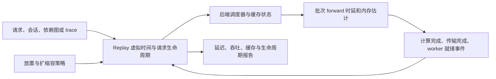
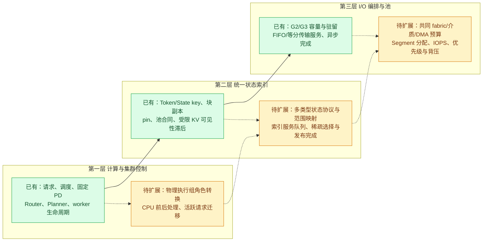

# DynoSim 官方基线能力边界与池化状态架构 Gap 分析

初稿日期：2026-10-19；源码复核与补充：2026-10-20。本文以本地固定提交为边界，交叉核查文档、实现、配置校验和测试用例；本轮未运行 WSL、重新编译、仿真或 GPU 实验。测试链接说明仓库中的预期行为与约束，不代表本轮重新执行通过。

**判断：这套基线适合继续用作性能研究底座。它已有请求与调度仿真、模型性能估计、固定 P/D、弹性 worker 生命周期，以及共享 G2/G3 缓存等基础。当前先研究固定部署瓶颈和 P/D 角色、部署模型的切换成本，forward 模型提供计算耗时依据；统一状态索引、forward 内稀疏召回、经池状态交接和多资源 I/O 编排属于后续按需扩展，完整三层方案无法靠新增几个 YAML 字段得到。**

目标规模为 256/384 卡、每节点 8 卡、每实例 8/16 卡，最终面向昇腾 950 系列。当前 Qwen3-32B-FP8/H200 小规模基线保持不变，后续先采用有适用性能证据的 GPU 场景建立方法与收益边界；950 校准后补，GPU 数值不直接作为 950 结果。完整目标、候选模型边界及校准项见[架构讨论稿第 2.5 节](C:/projects/PD一体化无状态推理/项目资料/PD一体化池化推理集群_架构讨论稿.md#target-scenarios)。

原稿的整体判断基本准确。本次主要补严以下边界，而不是推翻已有结论：

- **补已有能力**：按 P/D role 选择异构硬件、Intel B60/XPU 路径、固定 KV 事件可见性滞后、请求级 QoS、Belady 对照，以及受限的 Rust 外部步进接口。
- **补入口差别**：公共 `predict`、Dynamo Python SDK 和 native Rust 不是同一能力集合；CLI 出现参数也不等于所选 runner 接受它。
- **补模型假设**：whole-forward mixed batch 存在组合公式；`silicon` 来源可能包含插值；内存容量合同与时延数据必须分别合格。
- **收紧“状态缓存”含义**：已有 Token/State key、物理副本身份及生命周期；SSM/recurrent cache 主要是 metadata-only 模型，不等于真实 tensor 保存/恢复或统一状态服务。
- **补实验归因陷阱**：私有/共享 G2 不仅命中域不同，传输服务策略也不同；各方向、各 tier 的预算独立；带宽为 0 的含义因接口而异。
- **补输出边界**：goodput 中的 ITL 判定实际使用逐请求平均间隔，主延迟汇总偏向已完成请求；统计近似误差不等于仿真对实机的误差。

这些差异直接影响后续选择基线和扩展位置。下文中“需要新增”均是研究判断，不是已经决定开始修改仿真器源码。

## 1. 版本、证据和“支持”的含义

| 对象 | 本次依据 |
|---|---|
| AISimulate | `C:/projects/PD一体化无状态推理/仿真工具/aisimulate`，提交 `221b8163825c2526a9d050a0813d03a538c32e8e` |
| Dynamo | `C:/projects/PD一体化无状态推理/仿真工具/dynamo`，提交 `d94072d69df850d183ce0a98001b0029893f5bb2` |
| 既有安装与运行记录 | [WSL 安装与官方基线运行指南](DynoSim_WSL安装与官方基线运行指南.md) |
| 项目目标 | [PD 一体化池化推理集群架构讨论稿](C:/projects/PD一体化无状态推理/项目资料/PD一体化池化推理集群_架构讨论稿.md:19) |

Dynamo 的 [Cargo 依赖](C:/projects/PD一体化无状态推理/仿真工具/dynamo/Cargo.toml:237) 固定到上述 AISimulate 提交。本文的“当前”专指这对版本，不把后续上游更新并入结论。

判断一个场景能否可信仿真，需要依次确认四件事：

1. **能表达**：架构、精度、并行方式、资源与负载能够进入配置或模型图。
2. **能估计**：该模型 × 硬件 × backend/version × 并行 × phase × batch/长度，有适用的性能数据或明确的解析假设。
3. **能回放**：所选 runner 支持所需调度、缓存、拓扑和功能组合。
4. **有精度证据**：与该具体场景的真实执行测量比较过，且误差满足研究需要。

这四层不能相互替代。官方 [性能支持说明](C:/projects/PD一体化无状态推理/仿真工具/aisimulate/docs/perf-model/support-matrix.md:8) 和 [Replay 能力矩阵](C:/projects/PD一体化无状态推理/仿真工具/aisimulate/docs/replay/features.md:8) 也明确分开这些问题。

早期跑通的 6 请求用例是：单 aggregated worker、并发 2、ISL 32、OSL 4、P/D 各固定 1 ms、无 Planner、round-robin。该用例只验证功能链路，不能验证模型性能估计、共享缓存、PD 分离或池化性能。[安装与用例记录](DynoSim_WSL安装与官方基线运行指南.md)

2026-10-21 补充：之后已基于 Qwen3-32B-FP8 / H200 性能模型，完成 937 条 Mooncake 请求在 agg4、1P3D、2P2D、3P1D 下的静态对照，详见 [首轮结果分析](../reports/DynoSim_静态部署首轮结果分析.md)。这验证了当前实验路径及结果完整性，不代表仿真已与实机性能校准，也未验证动态角色切换或池化 I/O。

## 2. 仿真的核心对象与入口差别



核心执行的是请求、token 进度、缓存身份、容量和事件依赖；不会真实执行模型张量计算，也不会根据真实 logits 生成回答。Op-level 编译的是性能估计图，整次 forward 模型返回时延估计。实际 GPU kernel、文本质量、真实 RDMA/NDS/GDS 协议需要另行验证。[op-level 合同](C:/projects/PD一体化无状态推理/仿真工具/aisimulate/docs/perf-model/methods/op-level.md:8)

| 入口 | 适用范围 | 重要限制 |
|---|---|---|
| `--stack engine` | AIS 内置离线 Replay；许多新模型控制、grouped cache、state cache、EPD 等先在这里开放 | 内置 composition 为 round-robin、固定 worker；不能直接在这个默认 composition 中启用 Dynamo Planner |
| `--stack dynamo` | 相同底层 Replay 加 Dynamo Router/Planner 集成 | 当前 runner 宣告的能力较窄；不能继承 engine 的所有新特性；Agentic 集成为 `functional_only` |
| Rust native composition / Python SDK | 自定义 placement、scaling、观测和性能模型；部分能力先出现在这一层 | API 层次与公共 YAML 不同；底层可表达不代表 CLI 已接通或任意组合已验证 |
| Live Mocker / 真实服务 | 可以用于其他运行或集成验证 | 不属于这里已经跑通的离线 6 请求链路；不能把生产 Dynamo 的全部能力算入离线仿真 |

直接证据：[engine capabilities](C:/projects/PD一体化无状态推理/仿真工具/aisimulate/python/aisimulate/src/aisimulate/runner.py:376)、[Dynamo capabilities](C:/projects/PD一体化无状态推理/仿真工具/dynamo/components/src/dynamo/replay/simulation.py:62)、[未声明能力的拒绝逻辑](C:/projects/PD一体化无状态推理/仿真工具/aisimulate/python/aisimulate/src/aisimulate/sweeper/replay.py:447)、[native composition](C:/projects/PD一体化无状态推理/仿真工具/aisimulate/docs/adapters/native-composition.md:6)。

### 2.1 当前两个 CLI stack 的具体差别

下表描述固定源码中的准入与适配，不保证任意模型、后端和特性组合都能完成预测。

| 能力 | 内置 engine runner | Dynamo runner / SDK |
|---|---|---|
| vLLM / SGLang / TRT-LLM 的普通 agg / PD | 已声明；仍需对应数据与参数合法 | 已声明 |
| 放置与伸缩 | 默认 round-robin、固定 worker；native 可自定义 composition | 可接 KV Router、Planner |
| 公共 `predict --online` | 当前 factory 仅声明 offline，会被拒绝 | 当前 factory 显式仅声明 offline，也会拒绝 |
| grouped FPM cache、state cache | 声明了受限支持 | 未声明对应能力，不能沿用 engine 结论 |
| `cached_prefix_tokens` | 支持该抽象输入 | 未声明；不能与真实 prefix hash 命中混为一谈 |
| 显式 MTP expected acceptance 和受 capability 控制的 engine model controls | 有相应声明 | factory 未声明 `supports_mtp_expected_acceptance` / `supported_engine_model_controls`，相应活跃字段会被拒绝 |
| Agentic snapshot / warmup / continuous profile | 有受限路径 | 当前 factory 未声明这三项 |
| Agentic G2 | 有限定静态拓扑 | 不能仅凭 factory 没显式赋值就判为全部禁用；还要通过共同校验与 native 资格边界 |
| 定时 telemetry | Rust observer 已有；engine Python JSON runner 拒绝 capture | Dynamo runner 接入 `TelemetryOptions`；不代表任意详细 native artifact 可用 |
| `kv_event_lag_ms` | 不属于内置默认路由控制 | Python SDK / Rust 有；当前公共 YAML runner 未转发 |

`--online` 的帮助文本描述按墙钟节奏推进的意图，但参数解析与 runner 准入是两层逻辑。不能据 help 推导当前这两个公共 stack 可运行 online，也不能把它等同于在线 regression 学习或 Live Mocker 服务。[模式默认值与拒绝逻辑](C:/projects/PD一体化无状态推理/仿真工具/aisimulate/python/aisimulate/src/aisimulate/sweeper/replay.py:314)、[main 模式转换](C:/projects/PD一体化无状态推理/仿真工具/aisimulate/python/aisimulate/src/aisimulate/main.py:131)、[Dynamo 显式模式](C:/projects/PD一体化无状态推理/仿真工具/dynamo/components/src/dynamo/replay/simulation.py:80)。

### 2.2 虚拟时间与宿主机耗时不能混用

Replay 中的 placement、索引查询和 Planner 回调在给定 `now_ms` 下执行。调用这些 Rust/Python 函数实际消耗的 CPU 时间会影响仿真器 wall time，**不会自动变成被模拟请求的索引时延、调度 RPC 或 CPU 队列等待**。现有模型可以研究决策结果如何影响请求分配；研究索引服务自身瓶颈时，需要额外的服务时间、排队和完成事件。

同一虚拟时刻的处理顺序、完成后资源释放、再准入等已有明确合同。未来可以复用这些机制，但不能用 `time.time()` 测一次本地 HashMap 查询，就直接当作目标分布式索引服务的微秒级模型。[同步回调合同](C:/projects/PD一体化无状态推理/仿真工具/aisimulate/docs/adapters/native-composition.md:38)、[请求放置调用](C:/projects/PD一体化无状态推理/仿真工具/aisimulate/crates/core/src/replay/agg.rs:328)、[同时间戳阶段](C:/projects/PD一体化无状态推理/仿真工具/aisimulate/docs/replay/extending.md:31)。

## 3. 模型、算法和性能估计的覆盖范围

### 3.1 模型类别：已有的范围相当广，但不是任意模型即插即用

| 类别 | 固定源码中的已有能力 | 不应推导出的结论 |
|---|---|---|
| Dense Transformer、MHA/GQA | GPT、Llama、Qwen2/3 等架构族；attention/KV head 几何、计算和容量估计 | 不是填写任意 Hugging Face ID 就能得到准确预测 |
| MoE | DeepSeek、Mixtral、Qwen-MoE、GPT-OSS、MiniMax 等模型路径；MoE TP/EP、通信与专家负载分布参数 | 不执行真实 token router；某种专家分布假设不能证明所有业务的负载均衡表现 |
| MLA | DeepSeek V3/R1、Kimi K2.5 等成本和 latent KV 容量建模 | 不验证压缩表示或转换的数值正确性，也不自动实现通用状态恢复 |
| DSA | DeepSeek V3.2、GLM-5.2/5.3 等特定路径；indexer、top-k、attention、部分 CP 校正 | 不是通用稀疏算法插件；模型注册不等于每种 8/16 卡配置均有适用数据，必须满足几何、后端和并行限制 |
| DeepSeek V4 CSA/HCA | 专门的压缩/窗口/稀疏模块、Prefill CP 和 MoE 图 | 不能把其约束推广到其他稀疏模型；部分 MegaMoE 路径限制 backend 与并行方式 |
| DeepSeek V4.1-Flash CSA2 | text backbone 的 Full/Reindex/Reuse、窗口与跨层状态所有权、Engram/mHC 成本 | 当前模型图要求 TP 整除 8，Attention-DP/PP/CP=1、nextn=0；不能直接用于 TP16 或 TP8×PP2。视觉、DSpark、host-resident Engram 不在同一合同 |
| SSM、混合模型、线性注意力 | NemotronH/Mamba2、Qwen3.5、Kimi K3/KDA、Gemma4/HybridMoE 等图与内存路径 | 成本模型覆盖不等于递推状态 checkpoint、共享、卸载和恢复均完整覆盖 |
| 部分视觉模型 | vision encoder 成本、图片尺寸到 visual token 的映射；分析式 EPD | 不代表音视频和任意多模态 pipeline；也不代表有精确 encoder 排队与端到端 P99 |

来源：[架构注册表](C:/projects/PD一体化无状态推理/仿真工具/aisimulate/python/aisimulate/src/aisimulate_core/sdk/common.py:836)、[MoE 分布参数](C:/projects/PD一体化无状态推理/仿真工具/aisimulate/python/aisimulate/src/aisimulate_core/sdk/models/moe.py:136)、[DSA/CP](C:/projects/PD一体化无状态推理/仿真工具/aisimulate/docs/perf-model/methods/context-parallel-dsa.md:8)、[V4 模型](C:/projects/PD一体化无状态推理/仿真工具/aisimulate/python/aisimulate/src/aisimulate_core/sdk/models/deepseek_v4.py:64)、[V4.1 合同](C:/projects/PD一体化无状态推理/仿真工具/aisimulate/docs/perf-model/models/deepseek-v41.md:8)、[Kimi K3 状态代理](C:/projects/PD一体化无状态推理/仿真工具/aisimulate/python/aisimulate/src/aisimulate_core/sdk/models/kimi_k3.py:57)。

这里的模型列表表示已有实现路径，不能视为所有模型变体、硬件、框架版本与特性组合的白名单。逐个候选还需要查询和 Replay 验收。

### 3.2 性能模型有多条路径，证据强度不同

| 路径 | 如何得到耗时 | 使用边界 |
|---|---|---|
| fixed / polynomial | 固定值或公式 | 适合调度和生命周期实验；不能作为真实模型性能结论 |
| Op-level + SILICON | 使用适用的算子测量表、插值和已批准来源，组合成 forward | 有些操作本来就是解析项；模型可构建不代表每个运行 shape 都有数据 |
| Op-level + HYBRID / EMPIRICAL | 测量与有依据的解析/经验迁移组合 | 迁移结果不是新硬件实测；缺少必要校准时应失败 |
| SOL / SOL_FULL | 根据硬件规格和操作模型估计理论下界或其分解 | 不证明真实 kernel 达到这个速度；部分模型/操作不支持所有分解模式 |
| Whole-forward FPM direct | 查特定部署的整次 forward 实测 | 要匹配模型、硬件、backend/version、精度和并行身份；限测量点及允许的插值域，无任意域外外推 |
| Whole-forward SOL-assisted | 在规定域内用解析模型迁移实测锚点 | 可迁移域比一般模型图支持域更窄 |
| Online regression | 用实际迭代的 workload 与 wall time 拟合 | 未训练或无有效数据的 store 不能凭空预测；各 identity/store 独立 |

来源：[支持合同](C:/projects/PD一体化无状态推理/仿真工具/aisimulate/docs/perf-model/support-matrix.md:8)、[whole-forward](C:/projects/PD一体化无状态推理/仿真工具/aisimulate/docs/perf-model/methods/whole-forward.md:8)、[regression](C:/projects/PD一体化无状态推理/仿真工具/aisimulate/docs/perf-model/methods/online-regression.md:56)。

例如 V4.1 并非“完全没有实测”，仓库有专门的 GB300/B300、固定 SGLang 执行环境子库；但默认 HYBRID 中部分新模块仍可能来自未校准 SOL。必须记录实际加载的系统数据根、执行模式和来源，不能把某个专门子库的准确性套给默认配置。[V4.1 默认边界](C:/projects/PD一体化无状态推理/仿真工具/aisimulate/docs/perf-model/models/deepseek-v41.md:111)、[专门测量子库](C:/projects/PD一体化无状态推理/仿真工具/aisimulate/python/aisimulate/src/aisimulate_core/systems/profiles/dsv41/README.md:8)

普通 op-level 也不完整覆盖 TRT-LLM eager prefill/mixed 的 CPU 提交空洞与跨 rank 等待。`cuda_graph_reserved_bytes` 是容量参数，不能用来补出执行时延。整次 forward 实测可以包含测量当时的执行行为，却不能证明换一种 graph/eager 策略后仍准确。[性能模型限制](C:/projects/PD一体化无状态推理/仿真工具/aisimulate/docs/perf-model/limitations.md:8)

### 3.3 稀疏、量化和推测解码需要分别看

**稀疏不是一个统一开关。** 当前已实现某些 DSA/CSA/HCA/CSA2 模型的计算、流量和容量估计；这与执行真实 Q/K、动态选出历史 token、按 layer/head 生成远端读取集合是两件事。对你们的场景，后者还需要 selector 或访问 trace、物理范围映射和数据就绪依赖。

量化枚举包括 BF16、FP8、部分 INT8/INT4 weight-only、NVFP4/MXFP4，以及 KV 的 BF16/FP8/INT8 等。但这些是成本与内存身份，组合仍受模型、硬件和后端约束；它不评估量化导致的输出质量损失。[量化定义](C:/projects/PD一体化无状态推理/仿真工具/aisimulate/python/aisimulate/src/aisimulate_core/quantization.py:17)

推测解码至少有三层入口，不能混为一谈：

- 公共 `engine.speculation` 当前是 ngram 路径：offline engine、vLLM、agg/PD、显式 draft/acceptance 假设；不实际运行 ngram 查找，也不计其 CPU 成本，不支持与 G2/G3/Agentic 等任意组合。
- `nextn` / `nextn_accepted` 是另一条 MTP/EAGLE 相关入口；接受率由输入假设给出，不能从模型语义自动推导。
- SDK 成本 registry 还有 eagle3、dspark、dflash、draft_model 等。这些名称出现在 SDK 不代表公共 YAML、Dynamo runner 和完整集群回放都能使用。

来源：[ngram 与 MTP 的公共边界](C:/projects/PD一体化无状态推理/仿真工具/aisimulate/docs/replay/topology-and-scheduling.md:331)、[SDK speculation 目录](C:/projects/PD一体化无状态推理/仿真工具/aisimulate/python/aisimulate/src/aisimulate_core/sdk/speculation)。

### 3.4 整次 forward 测量仍有组合与插值边界

**whole-forward 不等于每个实际 mixed batch 都直接测量过。** 当前 FPM 的 mixed-rank 路径采用：

```text
T_mixed = T_prefill + max(T_decode - T_decode_baseline, 0)
```

P/D 查询可以来自实测表，但上述组合本身是建模假设；其对混合批次、长短请求组合和实际执行策略的准确性需单独验证。带 draft tail 或 `nextn > 0` 的 FPM telemetry dispatch 在此路径明确拒绝，不能从 SDK 中存在某种 speculative FPM 成本查询推导出 Replay 同样支持。[mixed 组合与拒绝条件](C:/projects/PD一体化无状态推理/仿真工具/aisimulate/crates/core/src/perfmodel/engine/runtime.rs:2218)

此外，FPM 的 `source="silicon"` 可以包含允许域内插值，不保证当前 query 就是原始测量点。应分别保留 measured/interpolated/unsupported 覆盖、支持点与权重、查表耗时、mixed baseline、correction 以及最终耗时；不要只保存一个 SILICON 标签。[查询证据含义](C:/projects/PD一体化无状态推理/仿真工具/aisimulate/docs/perf-model/api/python.md:127)、[插值实现与边界测试](C:/projects/PD一体化无状态推理/仿真工具/aisimulate/crates/core/src/perfmodel/operators/fpm_forward.rs:554)

特定模型还会进一步缩小入口：例如 DeepSeek V4.1 的 bounded decoder replay 需要每条请求的 extend-tail 信息，而现有 telemetry 对多个 fresh-prefill 请求不足以恢复该信息；即使 prompt 长度相同也会被拒绝。ngram 路径要求 op-level 或显式 timing，不能直接组合 whole-forward FPM。[V4.1 guard](C:/projects/PD一体化无状态推理/仿真工具/aisimulate/crates/core/src/perfmodel/engine/runtime.rs:2189)、[ngram 负向用例](C:/projects/PD一体化无状态推理/仿真工具/aisimulate/tests/test_ngram_cli.py:102)

### 3.5 内存容量与时延数据是两个独立合同

容量研究不能只看 KV 字节数：权重、activation、通信 workspace、图保留空间和在途 buffer 会影响可用容量。已有模型区分 backend 的预算语义，但不等于复现真实 allocator 的每次分配、碎片及空间立即可回收时刻。

FPM profile 的内存来源有 `pending / declared / runtime`：

- `pending` 不能被当成“缺项为零”；没有完成资源合同就不能进行缓存容量仿真。
- `declared` 要提供非 KV 资源并限制可接受的 scheduler envelope。
- `runtime` 记录要求 rank-local `max_num_tokens`、`max_batch_size` 等与采集条件精确一致；改变 scheduler 设置需要重新采集，不能随意线性放大测得缓存池。
- grouped cache 的多组 byte budget 没有通用等价的单一 token 容量；部分 grouped 字节观测只在 native observer，不在 Python JSON 输出。

这意味着“offload 减少了逻辑 KV 驻留”还不足以证明“真实 HBM 已经释放同样空间且可立即给新任务使用”。[FPM 内存状态与 envelope 校验](C:/projects/PD一体化无状态推理/仿真工具/aisimulate/python/aisimulate/src/aisimulate_core/fpm_profile.py:124)、[backend 内存预算](C:/projects/PD一体化无状态推理/仿真工具/aisimulate/python/aisimulate/src/aisimulate_core/sdk/memory.py:395)、[内存合同](C:/projects/PD一体化无状态推理/仿真工具/aisimulate/docs/perf-model/memory.md)

### 3.6 新模型并不总需要先实现逐算子图

这是已有的正向扩展能力：**合格的 direct FPM profile 可以接入尚未注册解析模型类的新架构**。现有测试验证了不生成逐算子图、使用 `FpmForward` 的路径；但仍要具备精确模型配置、资源合同、匹配实测表和 query coverage。相同未知架构不能自动获得 SOL 路径。[未注册模型 direct FPM 测试](C:/projects/PD一体化无状态推理/仿真工具/aisimulate/python/aisimulate/tests/unit/sdk/test_fpm_profile.py:269)

这条路径只替换 forward 的时间估计，不能补出新的 scheduler、逐层 KV I/O、跨步 overlap 或递推状态恢复语义。当前 guided self-benchmark 支持 vLLM 文本模型，SGLang、TRT-LLM 尚不受该引导采集流程支持。`validate-fpm` 验证 cold aggregated、单 client lane、HBM-only、无 speculation 范围内的回放完成和查询覆盖；成功后准确性仍为 `not_assessed`，实机精度需要另行执行 matched-serving 对照。[FPM self-service 边界](C:/projects/PD一体化无状态推理/仿真工具/aisimulate/docs/perf-model/fpm-self-service/README.md:25)、[validate-fpm 的精确范围](C:/projects/PD一体化无状态推理/仿真工具/aisimulate/docs/perf-model/fpm-self-service/implementation.md:1633)

## 4. 部署、并行、负载与调度能仿真到哪里

| 维度 | 已有能力 | 关键边界 |
|---|---|---|
| 聚合部署 | 一个 worker 内执行 Prefill/Decode；多个副本 | “聚合”不自动等于同一物理执行组可动态转换 P/D 专用角色 |
| 固定 PD 分离 | 独立 P/D worker pools；P/D 可采用不同并行配置和 attention-DP 数量 | 支持独立配置不代表任意布局间的 KV 转换被模拟 |
| 按 role 异构硬件 | P/D 可分别指定 hardware、容量与 timing，predict/recommend 有路径 | 每个 role 仍为同构 pool，公共模型/backend/version 受共同合同约束；不是任意节点/模型/后端混部 |
| 后端调度 | vLLM、SGLang、TRT-LLM 的准入、batch/chunk、容量与抢占等模型 | 不是直接运行对应版本的真实 Python/C++ scheduler；部分行为近似或未覆盖 |
| TP/PP/DP/EP/CP/DCP | 成本模型中存在这些维度及受限组合 | 当前标准性能模型驱动 Replay 要求 PP=1，schema 的 pipeline 字段不代表已实现流水服务回放；其他维度也不能任意正交组合。DCP 在已有 TP 内分 KV，不额外乘设备数；whole-forward DCP 目前只接 engine，未接 Dynamo/Planner |
| attention-DP | rank 独立 G1 与调度；P/D 两侧可不同 DP | group pass 以最慢 rank 完成时间为边界；不能据此推导细粒度异步 rank 执行 |
| 路由 | engine 内置 round-robin；Dynamo 可使用 KV-aware router 与负载预测 | overlap 是决策观测，不等于实际 cache reuse，更不等于数据已到 HBM；offline decode 路由不利用 overlap |
| 扩缩容 | native scaling seam / Dynamo Planner；startup、active、draining、移除 | 主要动作是目标副本数；不等于权重保留、物理设备重配置或活跃请求迁移 |
| AFD | A→A_TO_F→F→F_TO_A 的阶段 interval、pipeline fill 与节拍；含 AFD+PD 的受限路径 | 专用的确定性非抢占阶段模型；固定长度 synthetic，拒绝部分 chunk/spec/deadline 控制；不是通用分布式执行图仿真 |
| EPD | encoder 成本叠加到语言 Replay，并施加吞吐上限 | encoder 背压不回灌语言调度时间线；固定图片/长度/并发，主要输出均值，不能用于端到端排队/P99 结论 |
| 参数搜索 | `recommend` 在设备预算、SLA 与目标下重复 Replay，寻找候选配置 | 有限搜索不是全局最优证明；输出候选仍要做硬件验证；默认搜索空间不等于全部可表达拓扑 |

来源：[拓扑与 PD 传输](C:/projects/PD一体化无状态推理/仿真工具/aisimulate/docs/replay/topology-and-scheduling.md:8)、[DCP 边界](C:/projects/PD一体化无状态推理/仿真工具/aisimulate/docs/perf-model/methods/whole-forward.md:177)、[EPD](C:/projects/PD一体化无状态推理/仿真工具/aisimulate/docs/replay/topology-and-scheduling.md:284)、[Sweeper](C:/projects/PD一体化无状态推理/仿真工具/aisimulate/docs/sweeper/README.md:8)。

负载层支持 synthetic 单请求、多轮 session、固定并发、Poisson/固定到达率，以及 Mooncake、Dynamo、Weka/Agentic 等兼容 trace。Session 并发包含 think time；不同 trace 格式对 PD、Planner、停止条件的支持不同。Agentic 可表达依赖、分支与部分 snapshot/warmup，但 snapshot 是请求边界历史，不是设备物理 checkpoint。[负载合同](C:/projects/PD一体化无状态推理/仿真工具/aisimulate/docs/replay/workloads.md:48)、[格式兼容](C:/projects/PD一体化无状态推理/仿真工具/aisimulate/docs/replay/workloads.md:203)

尤其要注意“模型种类多”和“多模型混部”不同：Agentic importer 虽保留源模型标签，执行时仍投影到一个 `engine.model`，尚无每个节点异构模型 timing。普通多模型共池、LoRA 多租户、通用权重卸载、训练等，本次没有找到可作为官方完整回放能力的受支持路径。[单目标模型投影](C:/projects/PD一体化无状态推理/仿真工具/aisimulate/docs/replay/workloads.md:243)

硬件侧以 NVIDIA GPU 数据覆盖为主，包括 A100/H100/H200、B200/B300、GB200/GB300 等；**也已有 Intel B60/XPU 的系统描述、部分 vLLM 实测表与 oneCCL 通信路径**。B60 的 FP8 compute 项使用 BF16 fallback，部分 overhead 含经验参数，不能将其解释为完整硬件资格。未发现可把 Ascend/NPU 直接计入本基线覆盖的系统/后端合同；添加硬件 YAML 不能自动补齐 kernel、collective、内存和调度准确性。[B60 配置](C:/projects/PD一体化无状态推理/仿真工具/aisimulate/python/aisimulate/src/aisimulate_core/systems/b60.yaml:5)、[B60 数据目录](C:/projects/PD一体化无状态推理/仿真工具/aisimulate/python/aisimulate/src/aisimulate_core/systems/data/b60)、[oneCCL fallback](C:/projects/PD一体化无状态推理/仿真工具/aisimulate/crates/core/src/perfmodel/perf_database/communication.rs:302)

P/D role 异构使用 `workers.prefill.hardware`、`workers.decode.hardware`，代码要求存在适用的共同 backend version；这仍不包含设备间距离感知或布局转换成本。[编译校验](C:/projects/PD一体化无状态推理/仿真工具/aisimulate/python/aisimulate/src/aisimulate/compiler.py:191)、[异构配置用例](C:/projects/PD一体化无状态推理/仿真工具/aisimulate/tests/test_cli_config.py:1238)

系统描述中的 node/rack 带宽参数也不等于 fabric 图仿真：`get_p2p_bandwidth` 主要根据设备数是否跨 node/rack 阈值选择标量带宽，没有由此生成 NIC/switch/link 路径、链路队列或 collective 与池 I/O 的共享争用。[拓扑参数实现](C:/projects/PD一体化无状态推理/仿真工具/aisimulate/crates/core/src/perfmodel/common/system_spec.rs:103)

几十个逻辑 worker 可以表达目标实例数量，但 256/384 卡尚不是本项目已经运行和校准的规模；物理节点放置、8/16 卡资源组守恒及共享链路竞争需要按实验补足。当前使用匹配模型、后端、精度与并行配置的 GPU 性能数据；后续接入 950 时同时核对硬件规格、forward profiling、可用 KV 容量、通信/传输和调度行为，详见[目标场景与校准约定](C:/projects/PD一体化无状态推理/项目资料/PD一体化池化推理集群_架构讨论稿.md#target-scenarios)。

## 5. KV cache、卸载与召回：已有基础和真正的边界

### 5.1 已有的不是单纯“加一段固定传输时延”

| 机制 | 已实现内容 | 主要约束 |
|---|---|---|
| G1 设备缓存 | rank 本地容量、完整块 prefix reuse、分配/回收/抢占；命中受 token 身份和驻留影响 | 并行分片、backend admission 与完整块规则影响实际复用 |
| G2 私有 host cache | 每个 DP rank 一个池，D2H/H2D 独立 FIFO；容量、异步完成、源保护、目标预留 | 当前 native host offload 主路径为 vLLM prefix cache |
| G2 `cluster_shared` | deployment 共享容量与身份；跨 worker/rank 复用；rank 与 pool 双带宽上限、等分共享 | 参与者必须布局兼容；这是 simulator extension，没有同构原生 vLLM 共享池 parity reference |
| G3 | G2 下方的 worker_local/cluster_shared 层；写穿、连续前缀分级恢复、LRU、pin、容量、弹性生命周期 | 需要 G2；仅 aggregated vLLM、attention-DP=1；不支持 PD、recommend、speculation、AgentX 或真实硬件接入；动态生命周期有 native 测试，不等于默认 engine CLI 自动支持 scaling |
| Grouped FPM cache | 多 attention/convolution group、不同窗口/page、共享 byte budget 与原子跨组分配 | cold aggregated vLLM、PP1/CP1、HBM-only；prefix caching 关闭；无 PD/spec/offload |
| G1 recurrent-state/checkpoint cache | metadata-only：token KV 与 working/cached/recovery state 共享预算；checkpoint 复用、淘汰和副本计量，含细粒度匹配路径 | `predict --stack engine`、agg vLLM、固定 G1 容量；无 G2/G3/PD/recommend；自动几何仅 Kimi K3 的受限路径，不执行 state tensor 复制 |
| Best-effort Belady | native descriptor 可用未来输入 trace 的需求顺序选择淘汰对象；已有 LRU 对照 | 固定 agg、DP1、完整 open-loop 输入 trace；拒绝 PD、闭环生成流量、offload、scaling 等；不是公共 YAML 新开关，也不是严格的多 worker 吞吐最优上界 |

证据：[G1 与 grouped](C:/projects/PD一体化无状态推理/仿真工具/aisimulate/docs/replay/cache.md:14)、[G2 共享与传输](C:/projects/PD一体化无状态推理/仿真工具/aisimulate/docs/replay/cache.md:61)、[G3](C:/projects/PD一体化无状态推理/仿真工具/aisimulate/docs/replay/cache.md:378)、[SSM state cache](C:/projects/PD一体化无状态推理/仿真工具/aisimulate/docs/replay/cache.md:502)。

共享 G2 的移动速率按方向近似为 `min(rank_budget/rank_jobs, pool_budget/pool_jobs)`；首字节等待不占带宽，加入/完成/取消后重新分配。共享 G2 与 G3 分别使用这种预算服务，**私有 G2 则使用 FIFO**。不同 tier、读写方向的预算独立，未用份额不会完整再分配给其他受限 flow，尚不是统一多跳 fabric。G3 是连续流量近似，没有真实线程池或有限 job 并发深度；默认时延/带宽只是建模值。[服务模型实现](C:/projects/PD一体化无状态推理/仿真工具/aisimulate/crates/core/src/engine/offload_transfer.rs:4)、[私有与共享服务选择](C:/projects/PD一体化无状态推理/仿真工具/aisimulate/crates/core/src/engine/host_offload/tier.rs:261)、[G3 限制](C:/projects/PD一体化无状态推理/仿真工具/aisimulate/docs/replay/cache.md:443)

容量/带宽单位也必须统一：G2 `bytes_per_token: auto` 是一个 TP shard 的估计，不能直接混用整个 worker 的总 KV 字节与单链路带宽。[字节口径](C:/projects/PD一体化无状态推理/仿真工具/aisimulate/docs/replay/cache.md:86)

### 5.2 “forward 时卸载/召回”至少有四种不同需求

| 需求 | 当前结论 |
|---|---|
| 已计算的 prompt 完整块异步写到 host，后续请求恢复 prefix | **已有**；可与后续计算在虚拟时间上交错，并有源块保护和容量约束 |
| 冷 prefix 从 G3 经 G2 再入 G1 | **受限支持**；限上述 G3 合同，不是 PD 全路径 |
| Decode 每一步产生的新 KV，满块或尾块持续封存、发布到池 | **当前 host offload 不能直接代表**；需要补 Decode 增量状态及发布协议 |
| 每个 step/layer/head 按重要性选择历史 token，远程 gather 后才执行 attention | **需要新增核心建模**；现有 prefix 恢复不是这种访问路径 |

决定性的源码是 [host_offload.rs](C:/projects/PD一体化无状态推理/仿真工具/aisimulate/crates/core/src/engine/scheduler/vllm/host_offload.rs:550)：

```rust
let eligible_blocks = computed_tokens.min(prompt_tokens) / block_size;
let end = eligible_blocks.min(request.prompt_keys.len());
```

写穿范围被 `prompt_tokens` 与完整块截断。Decode 新生成的 token 不会因此自动成为持续卸载的全部历史状态。恢复端则从缺失部分开始查连续 `prompt_keys`，遇到 miss 停止；加载完成影响准入。[连续前缀恢复](C:/projects/PD一体化无状态推理/仿真工具/aisimulate/crates/core/src/engine/scheduler/vllm/host_offload.rs:243)

因此，若要研究你们的稀疏方案，至少需要：

`当前 step 的 Query/selector 成本 → layer/head/token 选择集合 → 地址与物理 tile → I/O 排队/传输 → 安装或布局转换 → attention 可运行 → 新状态封存/发布`。

仅将 `bytes_per_token` 乘一个稀疏比例，会遗漏 selector 成本、局部性、读放大、IOPS、跨步复用、预取失误与计算等待。相同数量的选中 token，连续分布和随机分布可能产生完全不同的结果。

### 5.3 共享缓存不等于“所有 P/D 都经池交接”

当前 P→D 支持源保留、目的预留、完成后激活和取消清理；传输可按 full_prompt 或 destination_missing 的字节量除带宽计时。但仍是单个请求级聚合传输，不建模 rank-wise 布局转换或网络争用。G1↔G2 与 P→D handoff 是不同操作。[handoff 合同](C:/projects/PD一体化无状态推理/仿真工具/aisimulate/docs/replay/topology-and-scheduling.md:23)、[与 G2 的区分](C:/projects/PD一体化无状态推理/仿真工具/aisimulate/docs/replay/cache.md:288)

你们要求的路径是 `P 写池 → 内容可发布 → D 读池 → 数据就绪/转换 → 执行`，不是把现有 P→D latency 调大。各段需要共用真实瓶颈预算，并区分写完成、源可复用、目的就绪、发布和持久化。

**术语提醒：AIS 的 G1/G2/G3 是缓存层级；架构稿把 L3 定义为用户的“逻辑池化状态服务层级”，不等同于某种介质。其三层详细设计另行划分职责：第二层负责状态索引与直通状态算子，第三层负责 I/O 编排、空间管理与基础 Segment IO。这些编号不能直接对应。**[目标术语定义](C:/projects/PD一体化无状态推理/项目资料/PD一体化池化推理集群_架构讨论稿.md:65)

### 5.4 索引与状态元数据已有基础，但还没有目标索引服务

已有实现不能概括为“完全没有索引”：

- G1 block pool 的 `CacheKey` 区分 `Token(SequenceHash)` 与 `State { prefix, slot }`，并以 `BlockCopyId` 管理同一 hash 的多个物理副本、引用、pin 和淘汰。
- G2 的 `HostBlockKey` 主要封装 `SequenceHash`，附带 parent hash、tokens hash、prompt block position 等元数据。
- 共享池 `kv_layout_id` 与 TP、block size/bytes、容量和带宽构成准入合同。不兼容会失败，**不会自动切分成不同布局的池或转换数据**。

这些机制适合复用作仿真内的对象身份和生命周期基础，尚不是独立的 `StateObject→全局 layer/head/token→Extent→Segment/unified_addr` 服务。现有 key 也不能自动提供多租户/模型版本 namespace、位置 epoch、地址代次、编码转换或 TP/PP view 重组。[G1 typed key 与副本](C:/projects/PD一体化无状态推理/仿真工具/aisimulate/crates/core/src/engine/cache/vllm_block_pool.rs:4)、[G2 key 与元数据](C:/projects/PD一体化无状态推理/仿真工具/aisimulate/crates/core/src/engine/host_offload/tier.rs:16)、[共享池合同](C:/projects/PD一体化无状态推理/仿真工具/aisimulate/crates/core/src/engine/host_offload/registry.rs:15)

`_kv_layout_id` 在有模型性能身份时使用 model/backend/version、并行和 KV 精度等信息；fixed/polynomial 路径缺少部分模型 timing 身份。因此 fixed smoke 中“layout 匹配”不能作为真实张量布局兼容的证明。[layout ID 构造](C:/projects/PD一体化无状态推理/仿真工具/aisimulate/python/aisimulate/src/aisimulate/runner.py:1846)

索引查询本身主要是进程内数据结构操作，例如 G2 `lookup` 直接返回 `Miss/Pending/Hit`。它没有独立的查询 CPU 队列、RPC、QPS 上限、批量合并、metadata DRAM 容量或 shard 竞争。第 7.2 节会说明已有的固定 KV 事件传播滞后；该能力仍不能覆盖完整索引服务成本。[lookup 实现](C:/projects/PD一体化无状态推理/仿真工具/aisimulate/crates/core/src/engine/host_offload/tier.rs:810)

### 5.5 SSM checkpoint 的“恢复”主要指什么

`state_cache_manager.rs` 明确定位为 **metadata-only recurrent-state caching**：`prepare_write`、`commit` 等管理工作副本、checkpoint、副本引用及容量，不复制真实 tensor，也没有给 state-copy 单独附加传输带宽与完成时延。显式指定 state bytes 可以做抽象容量实验，不能据此宣称验证了所有 Mamba/SSM/KDA 的状态恢复正确性。[state manager](C:/projects/PD一体化无状态推理/仿真工具/aisimulate/crates/core/src/engine/kv_manager/state_cache_manager.rs:4)

自动推导几何目前要求 vLLM、PP1，且仅支持 Kimi K3；其他 family 需提供手工 geometry。`prefix_match_unit` 只细化匹配，不会自动在每个匹配边界创建 checkpoint。例如已有测试采用物理 block 1536、匹配粒度 128，23700-token 的共享前缀只能恢复到已经存在的 23040 checkpoint，而不是任意一个 128-token 边界。[自动几何边界](C:/projects/PD一体化无状态推理/仿真工具/aisimulate/python/aisimulate/src/aisimulate_core/sdk/state_memory.py:65)、[对齐与恢复测试](C:/projects/PD一体化无状态推理/仿真工具/aisimulate/crates/core/src/engine/scheduler/vllm/core.rs:3677)

细粒度 `prefix_match_unit` 路径另有 speculation 限制；不能把它泛化为整个 state manager 的所有 MTP 分支都不存在。每项组合仍需逐入口校验。

### 5.6 容量、取消与带宽参数的实验陷阱

| 现有行为 | 对实验结论的影响 |
|---|---|
| 私有 G2 是 FIFO，共享 G2 是等分带宽服务 | 两者对照同时改变命中域、容量共享和服务策略，不能把全部差异归因于“共享命中率” |
| 读写方向与 G2/G3 tier 预算独立 | 当前不会自动争用同一个 PCIe/NIC/HBM/介质控制器；也没有与模型权重/activation 带宽统一竞争 |
| G2/G3 的底层传输服务将带宽 0 解释为无上限 | 不能用 0 模拟断链或停服 |
| P→D 公共带宽字段要求正值或省略；native 无有效估计时有 fallback | 要显式记录 bytes/token、带宽、timing mode 和 fallback，避免无意把交接成本置为零；不能套用 G2 的 0 值语义 |
| G2 对同请求缺失块 cohort 做容量准入 | 容量不足可能 `RetryCapacity`；cohort 本身大于池时也不会保证完整落池 |
| G3 写入可以只接受能放下的 leading blocks | G3 仍是缓存，不是全量可靠存储；G3 完成也不代表 G1 可读 |
| 小 G2 下的 G3 恢复可能反复无进展，最终 bypass 后重算 | 需要同时看恢复字节、bypass、miss 和重算，不能只用读字节数代表收益 |
| 私有 G2 取消不前移已排队的后续 deadline；共享服务会重分带宽 | 这不是通用硬件 abort/抢占模型；取消后的代价随 scope 不同 |
| G3 请求取消可 detach consumer，已接受 I/O 继续完成 | 客户请求结束与存储任务、pin/reservation 全部释放不是同一时刻 |
| 默认新 Replay 新建池；shared pool 在单次运行 scale-in 后可保留 | 不代表进程退出后的持久性、跨实验共享或崩溃恢复；自定义 driver 另有同进程共享 handle |

关键实现：[零带宽及公平服务](C:/projects/PD一体化无状态推理/仿真工具/aisimulate/crates/core/src/engine/offload_transfer.rs:21)、[P→D fallback](C:/projects/PD一体化无状态推理/仿真工具/aisimulate/crates/core/src/replay/handoff.rs:448)、[G2 cohort 准入](C:/projects/PD一体化无状态推理/仿真工具/aisimulate/crates/core/src/engine/host_offload/tier.rs:460)、[G3 容量准入](C:/projects/PD一体化无状态推理/仿真工具/aisimulate/crates/core/src/engine/g3_offload/tier.rs:206)、[G3 无进展恢复与取消](C:/projects/PD一体化无状态推理/仿真工具/aisimulate/crates/core/src/engine/scheduler/vllm/g3_offload.rs:4)、[同进程共享 handle](C:/projects/PD一体化无状态推理/仿真工具/aisimulate/crates/core/src/engine/host_offload/registry.rs:76)。

G3 的 native 扩缩容测试还明确区分 worker-local 内容随 worker 移除、cluster-shared 内容可供后来 worker 复用；这是单次仿真生命周期能力，不是持久存储恢复。[G3 scaling 用例](C:/projects/PD一体化无状态推理/仿真工具/aisimulate/crates/core/src/replay/agg_tests.rs:246)

Belady 可以提供利用未来输入需求的淘汰对照，但其 forecast 不知道未来 worker 放置，也不预测输出块需求；全局最优缓存命中、更高吞吐和更低尾延迟都不由此保证。它不应被当作目标在线 sparse selector 的可实现收益。[Belady 合同](C:/projects/PD一体化无状态推理/仿真工具/aisimulate/docs/replay/cache.md:300)

## 6. 哪些功能不能简单叠加

下面这些限制会直接影响实验设计：

| 看似可组合的场景 | 固定版本的实际边界 |
|---|---|
| PD + G3 | G3 明确不支持 PD |
| SSM checkpoint + host/G3 offload | state cache 限 G1；递推状态卸载不在当前合同 |
| 多组/混合窗口 cache + prefix reuse + PD | grouped FPM cache 限 cold agg HBM，不能这样组合 |
| MTP/ngram + G2/G3 | 当前组合被限制，不能同时假定二者收益 |
| Agentic + G2 + 任意规模 | 只覆盖静态单 agg 或 1P1D、vLLM、每 role DP1、无 G3/speculation；Dynamo 还需独立资格 |
| 多模型 Agentic trace | 执行投影到一个目标模型，不能模拟节点级异构 timing |
| DCP + Dynamo Planner | whole-forward DCP 的 downstream 支持尚未接通 |
| EPD + 精确端到端 P99 | 分析 overlay 仅支持规定均值等统计，缺 encoder 排队反馈 |
| ngram + whole-forward FPM | 当前要求 op-level 或显式 timing；不能直接叠加该 FPM 路径 |
| native Belady + 闭环流量 / PD / offload | 已有拒绝条件；未来输入 oracle 不是公共通用缓存策略开关 |
| 当前公共 `predict --online` + 任意 stack | engine / Dynamo factory 均只接受 offline；SDK online 和 Live Mocker 要分别核查 |
| 有详细 native artifacts + 任意多 worker/PD/scaling | 详细 artifacts 的支持域窄于普通报告，不能假定所有配置都有同等证据 |

正式矩阵：[Replay features](C:/projects/PD一体化无状态推理/仿真工具/aisimulate/docs/replay/features.md:14)。配置 validator 和所选 runner 的 capability 是最终准入依据，不能取不同模块能力的并集当作单一运行路径。

## 7. 对照你们的三层架构：差距集中在哪里

架构稿已经说明，你们项目的重心是“统一 LLM 状态索引与访问 + 配套 I/O 编排与池化适配”；E/P/D 弹性服务还有协同团队承担。因此，评估时应优先看第二层和第三层，不能只用“是否有 Planner”判断接近程度。[项目范围](C:/projects/PD一体化无状态推理/项目资料/PD一体化池化推理集群_架构讨论稿.md:7)



绿色节点表示可复用的现有模型与接口，橙色表示目标方案需要扩展的行为；跨层连线用于对照职责，不代表已有真实设备数据通道。KV 可见性滞后属于 Dynamo SDK/Rust 的受限能力，见第 7.2 节。

下表中的大小是**对仿真器结构的改动判断**：小表示以配置/实验为主；中表示新增局部策略或资源组件；大表示需要跨状态、事件依赖和资源协议扩展。它不是完成百分比或人天估算。

| 目标能力 | 可复用基础 | 需要新增或重构的部分 | Gap |
|---|---|---|---|
| 固定部署、固定 PD、prefix 容量/带宽研究 | 请求源、调度器、虚拟时间、G1/G2、报告 | 场景配置、性能来源校准、结果解释 | 小；可先做 |
| 第一层缓存亲和放置 | Dynamo selector、overlap、load projection、请求级 QoS、placement seam | 池路径成本、逻辑命中/可访问/HBM ready 区分、计算和 I/O ticket、TTL/epoch | 中到大 |
| 独立 Pre/PostProcess CPU 池 | workload 与事件框架 | CPU 服务时间/排队、流式背压、增量 detokenizer 状态与输出序号 | 中；若纳入一致性恢复则更大 |
| 同布局全部经池 P→D | source hold、destination reserve、handoff 取消清理、shared G2 | 写池/发布/读池/安装多段依赖、尾块、manifest、资源共用 | 中到大 |
| 排空后 P→D / D→P 的参数化切换近似 | scaling 回调、active/starting/draining 快照、可配置 startup delay | 先释放旧角色再启动新角色的配对策略、统一资源预算、冷/暖切换参数及初始缓存假设 | 小到中；可先用 SDK 策略实现，不要求复用同一个 worker 对象 |
| 精细的运行时角色转换与状态继承 | 上述生命周期与事件框架 | 随前态变化的切换成本、权重/图/通信组/HBM 重配置、缓存继承和必要的传输资源竞争 | 中到大；取决于是否保留状态、改变布局或迁移活跃请求 |
| 活跃 Decode 请求迁移 | handoff coordinator、生命周期框架 | 合法 step 停止、状态导出/恢复、owner 唯一性、采样与输出进度、旧端释放 | 大 |
| 统一 StateObject→Block→Extent→Segment | Token/State key、多副本身份、缓存容量、pin/reference 和共享池合同 | 多类型 namespace、版本/完整性、范围映射、分配代次、位置 epoch、发布/回收协议 | 大；总体架构扩展，非当前基线前置 |
| 索引服务自身性能 | 进程内查询、固定 KV 事件可见性滞后、虚拟时间事件框架 | lookup/update CPU 与 metadata 容量、RPC、分片队列、批量合并、并发与可见性协议 | 大；不能拿宿主机查询 wall time 代替 |
| 单权威表示和异构 TP/PP view | 模型几何、各 role 并行与字节估计 | 全局 layer/head/token 坐标、rank 视图、pack/shuffle、对齐、暂存和真实副本记账 | 大 |
| forward 内稀疏 recall 与跨步复用 | 稀疏模型成本、异步 transfer、虚拟时钟 | selector/访问 trace、逐层依赖、range gather、HBM working set、预取失误 | 大；总体架构扩展，非当前基线前置 |
| Decode 满块/尾块封存和增量发布 | 完整 prompt 块写穿、pending/resident 生命周期 | 增量状态、partial tail、分片 manifest、写完成与发布分开 | 大 |
| 多介质、拓扑与 I/O QoS | G2/G3 容量与 FIFO/等分带宽服务，当前各方向/tier 独立 | controller/fabric/DMA/HBM/转换共享资源、随机 IOPS、有限队深、读放大、deadline、非抢占粒度与背压 | 大；总体架构扩展，非当前基线前置 |
| MLA/SSM/Agent/Engram 统一状态池 | 相关模型图、部分 state cache、Agentic 请求图 | 类型专属组件与恢复规则、参数表访问、持久性和容错 | 大；应逐类型接入 |
| NDS/GDS 路径性能研究 | 可扩展传输事件与成本模型 | 注册/提交、直通或 fallback、staging、stream/event、visibility、布局转换测量 | 中到大；仅指仿真 |
| NDS/GDS 真实设备算子、正确性与故障恢复 | 仿真可提供设计与压力输入 | 真正 runtime/驱动/算子和设备测试 | 超出纯性能仿真，属于独立工程 |

对应需求：[角色转换](C:/projects/PD一体化无状态推理/项目资料/PD一体化池化推理集群_架构讨论稿.md:383)、[稀疏与封存](C:/projects/PD一体化无状态推理/项目资料/PD一体化池化推理集群_架构讨论稿.md:403)、[状态对象](C:/projects/PD一体化无状态推理/项目资料/PD一体化池化推理集群_架构讨论稿.md:521)、[状态接口与完成](C:/projects/PD一体化无状态推理/项目资料/PD一体化池化推理集群_架构讨论稿.md:626)、[I/O 编排](C:/projects/PD一体化无状态推理/项目资料/PD一体化池化推理集群_架构讨论稿.md:964)。

### 7.1 用现有扩缩容表达角色转换的范围

当前 [ReplayScalingDecision](C:/projects/PD一体化无状态推理/仿真工具/aisimulate/crates/core/src/replay/scaling.rs:226) 的主要动作是 `target_prefill`、`target_decode`、`next_tick_ms`。扩容创建新 worker，配置 `startup_seconds > 0` 时经历启动等待，未配置时可立即 ready；缩容先停止路由，旧请求继续 drain，完全排空才移除。[应用缩放](C:/projects/PD一体化无状态推理/仿真工具/aisimulate/crates/core/src/replay/disagg.rs:3111)、[排空检查](C:/projects/PD一体化无状态推理/仿真工具/aisimulate/crates/core/src/replay/components/engine.rs:447)

这里已经有较完整的逻辑生命周期：target 计 active + starting，draining 不算目标容量；缩容优先取消尚未启动的 worker，真正移除还要检查 pending pass、in-flight 和 engine 是否排空。worker-seconds/GPU-hours 也会计入 active、starting、draining 的占用。因此不能说基线完全忽略过渡占用；缺的是同一物理设备组跨角色复用的身份、守恒与加载机制。[三态占用统计](C:/projects/PD一体化无状态推理/仿真工具/aisimulate/crates/core/src/replay/disagg.rs:3074)、[扩缩容操作](C:/projects/PD一体化无状态推理/仿真工具/aisimulate/crates/core/src/replay/components/engine.rs:477)

**角色切换的仿真不要求复用同一个软件 worker 对象。** 若目标语义是“旧 P 停止接新任务、排空、释放执行资源，新 D 初始化后开始服务”，可以用旧 worker 退役和新 worker 上线表示；正确性取决于时间因果、资源预算和状态继承假设，而不是对象 ID 是否不变。

当前已有初始化不可服务窗口，但需要区分以下事实：

- `workers.<role>.startup_seconds` 经编译转为 startup delay；新增 worker 进入 starting，延迟到期后才注册路由、接受请求。它是**配置的虚拟时延**，不是仿真宿主执行 `factory.build()` 的实测耗时。
- 该延迟目前是每个 role 的固定参数，主要应用于运行中扩容；初始 worker 在构造时默认已就绪，不能把它当作完整的集群首次冷启动模型。
- 模型不自动从权重是否驻留、graph 是否可复用、旧角色、HBM 状态或传输拥塞计算初始化时间。可以为不同实验设定冷启动/暖切换的不同参数；若一场仿真中两种来源并存，就需按转换事件进一步区分成本。
- 新 D 默认是新建引擎状态；仅降低 startup delay 不会自动继承旧 P 的 G1、执行图或在途请求。第一版可以明确假定只保留权重/环境收益、G1 从冷态开始，随后再扩展缓存与请求继承。

“新 worker 的 G1 冷启动”也不表示整个共享池被清空。当前共享 G2 由 deployment 持有：worker 退役甚至 fleet 暂时降到零之后，池内驻留内容仍可供后续兼容 worker 恢复；测试还要求旧 worker 已接受的 D2H 写入完成后才真正移除。因此参数化切换可以保留共享缓存温度，排空成本也可能包含已接受 I/O 的尾部。这是生命周期与共享缓存的现有基础，仍不等于 P/D 必须经池交接或任意布局之间可直接复用。[共享 G2 缩容与再扩容用例](C:/projects/PD一体化无状态推理/仿真工具/aisimulate/crates/core/src/replay/components/engine.rs:1540)

最需要补的约束是**串联释放与启动**。当前同一个 scaling tick 下直接 `P-1、D+1`，会让 P 开始 drain，同时 D 开始 startup；它不会自动等待旧 P 释放同一组卡。因此，如果它们要复用同一物理执行组，不能直接把这两个独立动作当作完成的切换模型。

可以先用现有 SDK/native `scaling_policy` 做两阶段策略：缩 P → 观察对应 draining worker 真正消失 → 增 D。Python 回调能读取 active/starting/draining ID，并返回下一目标与 tick；不必为这一步重写社区 Rust 核心。它尚不是现成的 YAML“切换”开关，轮询 tick 也会引入检测延迟，分析时需记录。[Python scaling 回调](C:/projects/PD一体化无状态推理/仿真工具/dynamo/lib/bindings/python/rust/llm/replay.rs:2073)、[初始 worker 创建](C:/projects/PD一体化无状态推理/仿真工具/aisimulate/crates/core/src/replay/components/engine.rs:179)、[新增 worker 启动状态](C:/projects/PD一体化无状态推理/仿真工具/aisimulate/crates/core/src/replay/components/engine.rs:476)

第一版可采用保守的串行时间关系：

```text
t_D_ready = t_P_resources_released + T_switch(P→D)
T_switch = 可测量或显式假设的暖切换初始化时间
```

若一部分准备可与旧 P 排空重叠，再改为相应依赖图，而不是简单串行相加。不同 TP/PP 占用的设备数量、starting/draining 重叠、资源释放与缓存保留仍需一起记账。

因此，本项目可以先研究**固定成本的切换近似和成本敏感性**，之后再细化运行时重配置。不能因为基线创建了新对象就断言无法表达切换；也不能只把启动常数调小，就宣称已经模拟了权重、KV、图和活跃请求的完整暖迁移。

### 7.2 为什么 Router overlap 不等于池化数据就绪成本

Dynamo offline router 已有 G1 加权 G2 overlap 与负载投影，但其 [SchedulingRequest](C:/projects/PD一体化无状态推理/仿真工具/dynamo/lib/mocker/src/replay/offline/extensions/kv_router/mod.rs:375) 中 `kv_transfer_candidates`、`shared_cache_hits` 等并未接入对应候选信息。已有 G2 命中评分不代表目标所需的路径预留与 ready-time 预测。

也不能把“索引可见性滞后”全部算作空白：Dynamo Python replay SDK 已有 `kv_event_lag_ms`，仅用于 offline + kv_router，按固定虚拟时延延后 store/remove 等 KV 事件对 indexer 的可见性，默认 0；Prefill 完成与请求完成反馈并不随之统一延迟。**该参数当前未由公共 YAML runner 转发**，使用时要走相应 SDK/Rust 入口。[SDK 参数](C:/projects/PD一体化无状态推理/仿真工具/dynamo/components/src/dynamo/replay/api.py:264)、[入口校验](C:/projects/PD一体化无状态推理/仿真工具/dynamo/lib/bindings/python/rust/llm/replay.rs:175)、[事件滞后实现](C:/projects/PD一体化无状态推理/仿真工具/dynamo/lib/mocker/src/replay/offline/extensions/kv_router/mod.rs:793)

这给第二层提供了一个现成的敏感性实验入口，但不能代表索引查询服务排队、CPU/QPS 上限、metadata 容量、分片共识或数据 ready-time。需要分别测量和建模“索引知道对象存在”“查询完成”“传输完成”“目标 HBM 可用”。

请求级 QoS 也已有基础：`priority`、`strict_priority`、`policy_class` 会进入策略队列，相关测试覆盖 FCFS/LCFS/WSPT 等选择。它们不能自动下沉为 Decode recall、prefill fetch、writeback 的 I/O 优先级或硬件抢占行为。[请求字段](C:/projects/PD一体化无状态推理/仿真工具/aisimulate/crates/core/src/replay/protocol.rs:85)、[队列策略用例](C:/projects/PD一体化无状态推理/仿真工具/dynamo/lib/mocker/src/replay/offline/extensions/kv_router/mod.rs:1990)

架构稿的 `T_index + T_queue + T_media + T_fabric + T_install + T_transform` 可以作为初期预算分解；真实完成时间仍应按依赖图和共享资源求关键路径，不能在允许重叠时机械串行求和，也不能在有前后依赖时简单取最大值。[目标成本模型](C:/projects/PD一体化无状态推理/项目资料/PD一体化池化推理集群_架构讨论稿.md:1283)

### 7.3 哪些问题不能靠性能仿真给出答案

仿真可以评估“给定一种合格的稀疏选择策略与访问 trace，它对时延和容量有什么影响”，但不能自己证明该选择策略不损害质量。真实模型还需验证：稀疏 token 选择、量化/压缩、跨布局恢复、SSM 完整状态、推测分支提交等正确性。

同样，抽象的 pin/lease、完成事件可以做协议状态机检查，但不能证明 GPU/NPU cache coherence、DMA visibility、掉电持久性或驱动故障恢复。SSM 状态也不能当作任意历史 token 子集；Agent checkpoint 与 Engram 参数权威对象的持久性要求不同于可重算 KV。

当前也不是完全没有失败处理：handoff coordinator 有 Failed/TimedOut/Canceled 的清理路径，engine 协议有源、目的和请求取消原语。这些可以复用，但本轮没有发现公共的随机设备/节点/链路故障注入、MTBF、恢复重试与持久层恢复的完整仿真合同。[handoff 终态](C:/projects/PD一体化无状态推理/仿真工具/aisimulate/crates/core/src/replay/handoff.rs:31)、[取消命令](C:/projects/PD一体化无状态推理/仿真工具/aisimulate/crates/core/src/engine/protocol.rs:46)

## 8. 准确性和输出的适用边界

普通 Replay 可以输出请求延迟、TTFT/ITL/TPOT、吞吐及相关缓存/生命周期统计；可观察字段随 runner、capture 和拓扑而异。现有统计不能自动回答物理读放大、元数据延迟、转换成本、每层召回 deadline miss、实际副本数等新问题，这些需要新增观测。[报告与扩展归属](C:/projects/PD一体化无状态推理/仿真工具/aisimulate/docs/replay/extending.md:14)

有一个值得保留的官方实测对照：私有 G2、MiniMax-M2.5、TP2/attention-DP2、4×B200、5000 条 Mooncake。在该次实验中，G1+G2 combined reuse 的相对误差为 1.27%，mean TTFT 为 15.72%，mean TPOT 为 5.22%。这是单次 aggregate 对比，不是全局精度上界或重复实验 MAPE；原文还说明 simulator 与真实 vLLM 的版本、字节口径和 preemption/readmission 计数存在区别，不主张逐事件一致；shared G2 无原生对照。该证据文件明确标为 `acaca5d1` 来源的**历史资格记录**，不是当前 checkout 已重新复现的实验。[完整证据及限定](C:/projects/PD一体化无状态推理/仿真工具/aisimulate/benchmarks/evidence/accuracy/replay-evidence.md:8)

因此不能以 6 请求通过，或某个模型平均误差较小，推导出大型池化集群的 P99、稀疏 IO 或异构迁移已经准确。当前准确性证据需要按模型、硬件、runtime、拓扑、负载与测量边界逐点判断。[官方证据分层](C:/projects/PD一体化无状态推理/仿真工具/aisimulate/docs/ci/accuracy.md:6)

功耗也有专门边界：支持路径中的 `power_w` 是单 GPU 活跃 forward 的平均功率估计，不是整集群墙插功耗，也不包含 CPU、网络、存储、冷却与空闲功耗。不能直接用它比较整套池化方案的系统能耗。[功耗口径](C:/projects/PD一体化无状态推理/仿真工具/aisimulate/docs/perf-model/power.md:22)

### 8.1 指标和实验设计的额外边界

| 项目 | 当前语义与实验要求 |
|---|---|
| SLA 中的 `itl_ms` | 实际判定逐请求平均间隔 `(E2E - TTFT)/(OSL - 1)`；OSL≤1 时跳过该项，不是每一步最大 ITL 的 deadline |
| goodput | 只有配置 SLA 才有对应统计；E2E 与 TTFT/平均 ITL 两种门槛形式互斥，缺失不能填成 0 |
| 主延迟/吞吐汇总 | 主要使用 admitted 且 Completed 请求；必须同时检查拒绝、取消、失败、未完成及截断，避免只比较成功子集 |
| 分位数误差 | 部分 ITL/吞吐分布使用 0.1% 相对精度 DDSketch；这是统计近似，不是对实机误差上限 |
| 仿真时间与 host wall time | 前者用于请求指标，后者表示仿真执行成本；不能互换，也不能把 host 函数耗时自动当成索引服务开销 |
| 到达 seed | 固定 arrival seed 不一定固定 KV Router 的同分随机选择；需保存 selector/determinism 范围并做重复实验 |
| EPD 缺少 P99 / raw records | 是分析式 overlay 主动收窄输出，不能把语言部分的 P99 冒充多模态端到端 P99 |
| 捕获与规模 | detailed records、长 Agentic 历史和活跃状态会消耗宿主内存；存在资源监管不等于任意规模都可高效仿真 |

来源：[SLA 与 goodput 判定](C:/projects/PD一体化无状态推理/仿真工具/aisimulate/crates/core/src/replay/report.rs:901)、[completed cohort](C:/projects/PD一体化无状态推理/仿真工具/aisimulate/crates/core/src/replay/report.rs:1850)、[DDSketch 设置](C:/projects/PD一体化无状态推理/仿真工具/aisimulate/crates/core/src/replay/report.rs:21)、[Router 随机性与 canonical seam](C:/projects/PD一体化无状态推理/仿真工具/dynamo/lib/mocker/src/replay/offline/extensions/kv_router/composition.rs:96)、[EPD 输出过滤](C:/projects/PD一体化无状态推理/仿真工具/aisimulate/python/aisimulate/src/aisimulate/sweeper/epd.py:213)。

因此，平均 ITL 达标不能证明 sparse recall 没有偶发停顿。目标方案至少还需报告逐步 ITL、召回等待及 deadline miss、逻辑/物理字节、metadata 查询延迟、实际副本量和未完成请求占比。真实 OS/网络抖动和背景流量若没有显式建模，增加随机到达并不等于已经覆盖真实系统尾延迟。

### 8.2 调度配置对齐也是性能校准的一部分

同一份历史证据中，B200 上 Kimi-K2.5 的某个 DP8/EP8 场景，在并发 512 时，prefill schedule interval 从 1 调为 4，使 TPOT 相对偏差从 +94.1% 降到 +7.4%；并发 1024 时从 +73.4% 降到 +2.9%。这不是可推广的调优结论，而是说明**调度 cadence 对齐可能比替换某张算子性能表更重要**。[历史 cadence 资格记录](C:/projects/PD一体化无状态推理/仿真工具/aisimulate/benchmarks/evidence/accuracy/replay-evidence.md:63)

另一个有用的反例是 shared-G2 fixed-timing 示例：共享复用率提高，但 TTFT 也提高，因为固定计算耗时不会随命中减少，而 H2D 恢复新增了时间。这种用例适合检验生命周期，不适合直接证明 prefix cache 的性能收益。[共享 G2 示例与现象](C:/projects/PD一体化无状态推理/仿真工具/aisimulate/benchmarks/evidence/accuracy/replay-evidence.md:14)

### 8.3 显存占用、设备忙碌与算力利用率是三种不同指标

在与其他仿真器比较时，不宜笼统使用“支持显存和 GPU 利用率”这一项。当前源码能提供的观测如下：

| 研究问题 | 当前可用证据 | 边界 |
|---|---|---|
| 请求延迟、吞吐和排队 | Replay 请求报告；可选 telemetry 的 running/waiting requests、router pending 与分时请求统计 | 所选入口必须接通 capture；SLA、完成 cohort 和截断口径仍按第 8.1 节 |
| KV 池驻留和容量随时间变化 | 按 worker/rank 的 `active_blocks`、`inactive_blocks`、`total_blocks`、`active_cache_usage`、`physical_cache_usage`；grouped cache 另有可选 used/capacity bytes | 反映仿真池的逻辑/驻留状态，不是完整 CUDA allocator、碎片、临时 workspace 或 `nvidia-smi` 的实测显存曲线；KV 页释放也不等于预分配显存返还设备 |
| 部署占用了多少卡时 | `prefill_worker_seconds`、`decode_worker_seconds` 和派生 `gpu_hours` | **计 active、starting、draining 全部已配资源时间**，包含空闲与等待；不能把这个数当作实际计算时间 |
| worker 有多少时间正在执行 forward | 内部 pass 起止事件可以作为扩展统计的基础 | 当前标准报告没有完整 busy-ratio 曲线；Planner 的 `LatestFpmBuffer` 仅保留最近快照，会合并多次 pass，不能直接积分成完整忙碌时间 |
| 设备 SM 利用率、MFU/HFU、内存控制器利用率 | 本轮未找到可直接输出这些硬件计数器等价曲线的标准 Replay 指标 | 请求排队、KV 占用、预测 forward latency 和 provisioned GPU-hours 均不能替代它们；MFU 还需明确 FLOPs 口径与时间窗口 |

依据：[telemetry 字段及后端口径](C:/projects/PD一体化无状态推理/仿真工具/aisimulate/crates/core/src/replay/telemetry.rs:27)、[worker-seconds 与 GPU-hours 定义](C:/projects/PD一体化无状态推理/仿真工具/aisimulate/crates/core/src/replay/report.rs:114)、[latest FPM 合并](C:/projects/PD一体化无状态推理/仿真工具/aisimulate/crates/core/src/replay/scaling.rs:18)、[detailed artifacts 的实际字段](C:/projects/PD一体化无状态推理/仿真工具/aisimulate/crates/core/src/replay/artifact.rs:130)。

还要区分 runner：Dynamo adapter 会按 output requirements 接通定时 telemetry 并返回数据；当前 engine Python JSON runner 对 `capture_telemetry` 显式拒绝。这不表示底层 Rust 引擎没有观测能力，也不表示默认 `predict` 表格已经包含时序曲线。[Dynamo telemetry 接入](C:/projects/PD一体化无状态推理/仿真工具/dynamo/components/src/dynamo/replay/simulation.py:153)、[engine JSON runner 限制](C:/projects/PD一体化无状态推理/仿真工具/aisimulate/python/aisimulate/src/aisimulate/runner.py:465)

做池化方案实验时，建议先比较请求指标、KV 驻留、I/O 等待和资源占用卡时；如果要展示“算力利用率提升”，另建明确的 busy/FLOPs 计量合同，并说明计算、传输和空闲的重叠如何计量。

## 9. 建议的最小扩展路线与验收条件

**当前推进顺序：固定部署瓶颈 → 参数化 P/D 角色转换 → 部署模型切换 → 按需要细化状态与 I/O。** 现有 Qwen3-32B-FP8/H200 的 `agg1` 检查及 4 卡 `agg4`/`1P3D`/`2P2D`/`3P1D` 对照保持不变，当前均为单卡 worker、TP1/PP1/Attention-DP1。先建立静态对照，再用第 7.1 节的排空与启动机制扫描正收益转换时间边界；正式仿真结果以实际 WSL 运行记录为准。

部署模型切换当前没有现成完整实现：第 4 节所述单目标模型投影，需要扩展为请求模型身份、按模型 timing/内存合同、权重驻留与加载/卸载、资源组及路由生命周期。不能仅减小 startup 常数，就认为已经建模不同模型之间的切换。

下表 A2–F 是**后续按研究问题选取的扩展清单**，不表示必须完成 B/C/D 才能研究角色转换。进入池化专项时，再固定一种状态、一种布局、一条池路径，使用已有适用 timing 数据的模型、同构设备和受支持并行配置；池中先记录身份/范围/字节，后续逐步扩大。950 实测数据未补齐前，GPU 场景与假设性敏感性分析分开标注。

| 阶段 | 实验内容 | 能验收什么 |
|---|---|---|
| A：官方能力基线 | 在 6 请求之外验证真实 timing；固定 agg/PD；G1、私有 G2、共享 G2 的合法对照 | 功能与性能来源分开；共享容量、带宽、复用和排队效果可解释；不把 G3 塞进 PD |
| A2：索引观测与成本分离 | 在 SDK 合法范围内扫描 `kv_event_lag_ms`；另列待新增 lookup/update 服务成本 | 区分观测滞后、查询完成、数据命中与 HBM ready；不把滞后参数当作完整索引开销 |
| B：最小经池交接 | 同布局 `P→write→publish→D read→ready→compute` | 未发布不可读，未 ready 不执行，源不能提前释放，容量非负、字节与副本记账一致；零 IO 成本退化到约定基线 |
| C：单介质共享 IO | Prefix load、Decode recall、sealed-block put 共用链路/队列 | 竞争反映到队列和 ITL；服务不突破资源上限；FIFO/优先级/分片影响可解释 |
| D：forward 稀疏依赖 | 相同稀疏率下比较连续/随机 token；逐层 ready；跨步复用与预取 | 区分逻辑字节、物理字节、IOPS、读放大；不使用未来 Query 的完美预知；报告 selector 与 install 成本 |
| E：受控角色转换 | 先用 SDK policy 串行化旧角色 drain 与新角色启动，扫描冷/暖切换成本；再研究状态保留、混跑与活跃迁移 | 第一版验证设备预算与就绪时间；精细版再验证 owner 唯一、状态继承和输出进度连续 |
| F：扩展与校准 | 异构 TP/PP、MLA/SSM 等多状态、多介质、真实 NDS/GDS 测量 | 每增加一种能力都同时增加其布局/恢复/资源合同和精度证据 |

最终沿用架构稿的 2×2：固定/动态 P/D × 本地缓存/池化状态。必须统一设备、存储、fabric 与过渡缓冲预算；池化组遵守经池交接。只增加共享 G2 的对照有研究价值，但不能将其直接命名为目标完整池化方案。[目标实验矩阵](C:/projects/PD一体化无状态推理/项目资料/PD一体化池化推理集群_架构讨论稿.md:1306)

设计上述对照时还需固定：计时来源与 mixed 组合方式、内存 envelope、按 TP shard 或整个 engine 计量的字节口径、传输服务策略、缓存初始温度、请求完成 cohort 和 SLA 定义。比较私有/共享 G2 时，如果同时改变 FIFO/等分服务，需将其列作实验变量；性能实验不沿用固定 1 ms 的功能 smoke 结论。

建议每次结果附带最小实验清单：两仓 SHA、stack/SDK/native 入口、模型与 tokenizer/config 身份、backend/version、各 role 硬件/并行、资源内存来源、timing 数据根与查询覆盖、trace/hash/seed、缓存与带宽单位、取消/截断规则及重复次数。任何新增仿真假设都与原有实测依据分开标注。

对于 HHM/HBF，当前仍缺明确硬件合同。分别报告容量、带宽、首字节时延、随机 IOPS、可控层级与一致性等假设，做敏感性和盈亏边界；拿到 microbenchmark 后再校准。不能把假设曲线命名为硬件实测预测。[硬件待定项](C:/projects/PD一体化无状态推理/项目资料/PD一体化池化推理集群_架构讨论稿.md:1197)

单副本也不能在实现时默认定案。架构稿仍区分“严格物理单副本”和“单权威表示 + 有界缓存副本”；HBM 驻留、迁移重叠、在途缓冲、冷热副本及容错副本都应分别计量。cross-token-wise 的算法含义也需先明确，不能默认未来选择已知。[单副本口径](C:/projects/PD一体化无状态推理/项目资料/PD一体化池化推理集群_架构讨论稿.md:84)、[稀疏依赖](C:/projects/PD一体化无状态推理/项目资料/PD一体化池化推理集群_架构讨论稿.md:414)

## 10. 源码扩展应落在哪些位置

| 需要改进的行为 | 优先阅读与扩展位置 |
|---|---|
| 请求/依赖/selector 访问 trace 输入 | [loadgen](C:/projects/PD一体化无状态推理/仿真工具/aisimulate/crates/core/src/replay/loadgen)、[公共配置与编译](C:/projects/PD一体化无状态推理/仿真工具/aisimulate/python/aisimulate/src/aisimulate/compiler.py:35) |
| 全局事件顺序、虚拟时钟、设备生命周期 | [replayer.rs](C:/projects/PD一体化无状态推理/仿真工具/aisimulate/crates/core/src/replay/replayer.rs:360)、[agg.rs](C:/projects/PD一体化无状态推理/仿真工具/aisimulate/crates/core/src/replay/agg.rs:859)、[disagg.rs](C:/projects/PD一体化无状态推理/仿真工具/aisimulate/crates/core/src/replay/disagg.rs:925) |
| 经池交接与迁移协议 | [Replay handoff](C:/projects/PD一体化无状态推理/仿真工具/aisimulate/crates/core/src/replay/handoff.rs)、[engine Command](C:/projects/PD一体化无状态推理/仿真工具/aisimulate/crates/core/src/engine/protocol.rs:29)、[handoff timing](C:/projects/PD一体化无状态推理/仿真工具/aisimulate/crates/core/src/engine/handoff.rs:65) |
| 状态就绪、分配与 forward 依赖 | [engine](C:/projects/PD一体化无状态推理/仿真工具/aisimulate/crates/core/src/engine)、[vLLM offload 接入](C:/projects/PD一体化无状态推理/仿真工具/aisimulate/crates/core/src/engine/scheduler/vllm/host_offload.rs:243) |
| 池容量和传输资源模型 | [offload_transfer.rs](C:/projects/PD一体化无状态推理/仿真工具/aisimulate/crates/core/src/engine/offload_transfer.rs:4)、[G2 tier](C:/projects/PD一体化无状态推理/仿真工具/aisimulate/crates/core/src/engine/host_offload/tier.rs)、[G3 tier](C:/projects/PD一体化无状态推理/仿真工具/aisimulate/crates/core/src/engine/g3_offload/tier.rs) |
| 池感知放置、角色转换策略 | [native composition](C:/projects/PD一体化无状态推理/仿真工具/aisimulate/docs/adapters/native-composition.md:6)、[scaling](C:/projects/PD一体化无状态推理/仿真工具/aisimulate/crates/core/src/replay/scaling.rs:197)、[Dynamo router](C:/projects/PD一体化无状态推理/仿真工具/dynamo/lib/mocker/src/replay/offline/extensions/kv_router/mod.rs:355) |
| 索引可见性敏感性实验 | [Dynamo SDK 参数](C:/projects/PD一体化无状态推理/仿真工具/dynamo/components/src/dynamo/replay/api.py:264)、[滞后 KV 事件队列](C:/projects/PD一体化无状态推理/仿真工具/dynamo/lib/mocker/src/replay/offline/extensions/kv_router/mod.rs:793)；完整索引服务排队另建模型 |
| 外部事件驱动的聚合实验 | [SteppableReplay / SteppableAgg](C:/projects/PD一体化无状态推理/仿真工具/aisimulate/crates/core/src/replay/loadgen/steppable.rs:105)，见下文范围；不直接等同于公共 CLI 或 PD driver |
| 新指标与校准来源 | [report.rs](C:/projects/PD一体化无状态推理/仿真工具/aisimulate/crates/core/src/replay/report.rs:984)、[性能模型扩展说明](C:/projects/PD一体化无状态推理/仿真工具/aisimulate/docs/perf-model/extending.md) |

保持同一逻辑时域和明确的时间推进方。直接使用 `Replayer::run` 时，由其内部循环管理事件；也可以研究现有 Rust `SteppableReplay` 接缝，通过 `submit/cancel/step_until/next_event_ms/take_report` 与外部离散事件驱动器协调。**当前源码直接提供的具体实现是聚合的 `SteppableAgg` 和单 engine 包装 `SteppableEngine`，不能只根据 trait 注释泛化成现成的 PD、任意 composition 或公共 Python CLI 步进接口。**[导出类型](C:/projects/PD一体化无状态推理/仿真工具/aisimulate/crates/core/src/replay/loadgen/mod.rs:36)、[具体实现](C:/projects/PD一体化无状态推理/仿真工具/aisimulate/crates/core/src/replay/loadgen/steppable.rs:215)

这个接口让外部调用方负责并发限制和时间协调；终态释放名额后可以在同一时刻补入请求，但非终态 token 返回前可能已经提交下一 pass，因此已知的同时间戳到达需要在推进前提交。`take_report` 要求 runtime 空闲，可在同一存活 runtime 中切换统计 epoch；这不是进程间持久 checkpoint。它也不自动提供 pass 内逐层暂停、selector、pool I/O 和 HBM ready 的完整依赖，相关 engine 模型仍需扩展。[步进与统计合同](C:/projects/PD一体化无状态推理/仿真工具/aisimulate/crates/core/src/replay/loadgen/steppable.rs:5)

无论采用哪种驱动方式，placement 决策不能代替 engine 分配，也不能把在途 KV 当作已就绪。完成、取消、缩容必须各自恰好释放一次资源。新增公共 capability 时，native 校验也需同步，直接 Rust/SDK 调用不能绕开组合限制。[官方扩展约束](C:/projects/PD一体化无状态推理/仿真工具/aisimulate/docs/replay/extending.md:25)

**当前先推进固定部署基线，再以 SDK 策略实现排空后固定成本的 P/D 转换近似，随后补部署模型切换。** 同布局经池交接是后续池化专项的可控扩展；完整的稀疏池化 forward、保留状态的精细运行时角色转换和多介质编排，才构成较大的仿真器研发工作。基础事件框架、性能估计和调度器值得复用，目标状态与 I/O 模型仍需逐步建立。真实质量与设备协议验证保留独立原型。

## 11. 后续可复核的源码与用例索引

以下是本轮静态审阅使用的部分入口。正向用例用于寻找已有行为，负向用例用于确认组合限制；本轮未执行这些测试，也不把测试存在等同于性能精度验证。

| 待复核问题 | 实现或用例入口 | 能提供的证据 |
|---|---|---|
| 公共 stack 到底接受哪些字段 | [RunnerCapabilities](C:/projects/PD一体化无状态推理/仿真工具/aisimulate/python/aisimulate/src/aisimulate/sweeper/replay.py:314)、[runner tests](C:/projects/PD一体化无状态推理/仿真工具/aisimulate/tests/test_runner.py) | 入口声明、模式与能力拒绝，不是模型精度 |
| P/D 异构是否只是字段 | [CLI config tests](C:/projects/PD一体化无状态推理/仿真工具/aisimulate/tests/test_cli_config.py:1238)、[search space tests](C:/projects/PD一体化无状态推理/仿真工具/aisimulate/tests/sweeper/test_search_space.py:205) | 共同 backend version、候选生成与 role 资源校验 |
| shared G2 的合法起点 | [shared-g2-predict.yaml](C:/projects/PD一体化无状态推理/仿真工具/aisimulate/examples/cli/shared-g2-predict.yaml)、[host offload CLI tests](C:/projects/PD一体化无状态推理/仿真工具/aisimulate/tests/test_host_offload_cli.py) | 共享容量与传输路径、非法组合和 CLI 连接 |
| G3 边界与容量截断 | [G3 CLI tests](C:/projects/PD一体化无状态推理/仿真工具/aisimulate/tests/test_g3_offload_cli.py:127)、[native scaling test](C:/projects/PD一体化无状态推理/仿真工具/aisimulate/crates/core/src/replay/agg_tests.rs:246) | 完整块、容量、PD/DP/recommend 拒绝与共享内容生命周期 |
| state cache 是否等于通用 SSM 恢复 | [state cache config tests](C:/projects/PD一体化无状态推理/仿真工具/aisimulate/tests/test_state_cache_config.py)、[metadata state manager](C:/projects/PD一体化无状态推理/仿真工具/aisimulate/crates/core/src/engine/kv_manager/state_cache_manager.rs:4) | 显式几何、共享 G1 预算、checkpoint 元数据行为 |
| 新模型可否不补 op graph | [FPM profile tests](C:/projects/PD一体化无状态推理/仿真工具/aisimulate/python/aisimulate/tests/unit/sdk/test_fpm_profile.py:269) | 未注册架构 direct 路径、资源必须完整、SOL 拒绝条件 |
| mixed FPM 如何组成耗时 | [runtime.rs](C:/projects/PD一体化无状态推理/仿真工具/aisimulate/crates/core/src/perfmodel/engine/runtime.rs:2218)、[FPM lookup tests](C:/projects/PD一体化无状态推理/仿真工具/aisimulate/crates/core/src/perfmodel/operators/fpm_forward.rs:1145) | 组合公式、插值与支持域，不等于该组合实机已验证 |
| ngram / AFD / EPD 的组合 | [ngram CLI tests](C:/projects/PD一体化无状态推理/仿真工具/aisimulate/tests/test_ngram_cli.py)、[AFD runner tests](C:/projects/PD一体化无状态推理/仿真工具/aisimulate/tests/test_afd_runner.py)、[EPD tests](C:/projects/PD一体化无状态推理/仿真工具/aisimulate/tests/sweeper/test_epd.py) | 被拒绝的控制与输出限制 |
| 索引事件滞后与请求队列 | [KV Router tests](C:/projects/PD一体化无状态推理/仿真工具/dynamo/lib/mocker/src/replay/offline/extensions/kv_router/mod.rs:2307) | 固定 KV 可见性滞后及终态反馈的区分 |
| 带宽公平、独立方向与取消 | [offload_transfer.rs](C:/projects/PD一体化无状态推理/仿真工具/aisimulate/crates/core/src/engine/offload_transfer.rs:202) | 服务模型单元语义，不是物理 fabric 性能 |
| 外部步进时的同时间戳语义 | [steppable.rs](C:/projects/PD一体化无状态推理/仿真工具/aisimulate/crates/core/src/replay/loadgen/steppable.rs:105) | 聚合/单 engine 的动态提交、取消、统计 epoch 与补位顺序 |

阅读实现时建议先看配置 validator，再看执行分支和正/负测试，最后看精度证据。对待研究的组合，应写成“哪一个入口 + 哪个模型/硬件/后端 + 哪组功能 + 哪个测量合同”，而不是简单写“DynoSim 支持某功能”。

## 12. 与社区 SGLang Simulator、LLMServingSim 的选型定位

2026-10-20 的补充审阅见 [社区 SGLang Simulator 能力与 Tair HiSim 差异分析](C:/projects/PD一体化无状态推理/项目资料/SGLang_Simulator_能力边界与Tair_HiSim差异分析.md) 和 [LLMServingSim 能力与适配分析](C:/projects/PD一体化无状态推理/项目资料/LLMServingSim_能力边界与池化状态架构适配分析.md)。后续讨论 HiSim 家族的默认阅读、试跑和跟进入口，采用本地 `sglang-focus-on-hisim/tools/sglang-simulator` 中的社区实现；[Tair HiSim 报告](C:/projects/PD一体化无状态推理/项目资料/HiSim_能力边界与池化状态架构适配分析.md) 保留为历史实现与差异对照。各报告仍以记录的本地提交为边界，不把 roadmap、可选依赖或另一个仓库的能力直接计入当前实现。

**当前以 DynoSim 作为固定部署和角色/模型切换实验的主框架，同时按研究问题使用另外两者作参考。** 理由是现有请求链、固定 PD、scaling/startup/drain、性能估计与结果统计已形成可复用基础；角色转换需要补足资源配对和成本，模型切换仍需新增生命周期。已有共享 G2 可供后续池化研究参考；已经跑通环境只降低起步成本，不构成技术选型的主要理由。

若后续研究进入状态索引与层内 I/O，且结果主要取决于 forward 内逐层 selector→索引→gather→attention 的依赖和重叠，再验证 LLMServingSim 的细图扩展。可先吸收成本模型或生成整次 forward 画像；需要与共享 I/O 同时推进层内事件时，才进一步评估联合仿真或更换执行模型。Dyno 当前 pass 预先提交完成时刻，没有现成逐层外部 I/O 暂停/恢复；LLMServingSim 现有回读也只是 batch 前置整笔操作，不能直接宣称支持任意动态稀疏召回。详细比较、最小实验和判断门槛见[能力全景对比第16节](C:/projects/PD一体化无状态推理/项目资料/推理仿真工具_能力全景对比.md)。

| 近期研究问题 | 建议优先位置 | 选型时必须保留的边界 |
|---|---|---|
| 集群请求负载、缓存亲和、动态 P/D 数量与切换成本敏感性 | DynoSim 主线 | 现成动作是扩缩容；同卡复用仍需串联 drain/startup、固定预算与冷暖参数，见第 7.1 节 |
| SGLang 调度、HiCache 前缀树与分层缓存的实际控制流 | 社区 SGLang Simulator 作为行为对照 | 提供 AIC、ML、批次 replay 三种预测器并适配同仓缓存接口；当前 D2H 备份估时被记录，但未作为请求完成依赖推进时钟，L3 写入也立即确认，不能直接据此推导写侧竞争已经建模 |
| CPU/CXL/PIM 容量语义、执行 trace 与并行系统的探索 | LLMServingSim 作为辅助 | 容量/驻留、时间、能耗是不同合同；其 Decode 完整块写穿具备状态更新路径，但同步 metadata 更新不等于带宽与背压模型；analytical backend 明示不建模拥塞 |
| 全部 PD 经池交接、统一 StateObject 索引、逐层稀疏 gather、NDS/GDS 路径 | 三者均需扩展 | 不能把有缓存、块 ID、L3 或卸载功能直接算作目标设计已被支持 |

旧 Tair HiSim 的可选 KVCM Optimizer 接口漂移属于该旧实现的对接问题，**社区 SGLang Simulator 当前没有这一接入路径，不能把该问题或对应功能移植为社区版的结论**。Tair 仓内 KVCM 与 Optimizer/LiteHit 作为独立的缓存管理、策略分析组件另行参考，不需要为了解 HiSim 仿真主线同时维护两套环境。LLMServingSim 的外部 ASTRA 子模块等运行前置问题，详见对应报告；这些应作为当前可运行性的检查项，不应直接推论为项目原理不可行。反过来，某个工具支持 Decode 满块写穿语义，也不能跳过写入完成、源端保护、队列竞争和元数据发布时间的审查。

下一步无需同时搭建三套完整实验平台。先在 DynoSim 上固定一个受支持模型/trace，得到请求性能、KV 驻留和资源卡时的可解释基线；若关键问题落在 SGLang 行为或 CXL/PIM 上，再有针对性地运行对应工具。更换主仿真器的判据应是：**目标机制的依赖与资源约束更容易正确表达，且能用相同工作负载、相同指标定义和可靠测量完成校准**，而不是代码更少、功能列表更长或某个示例的平均误差更低。
