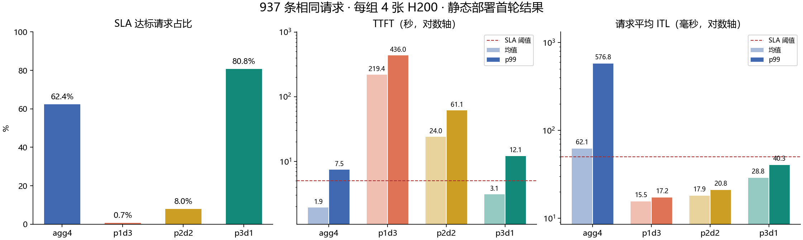
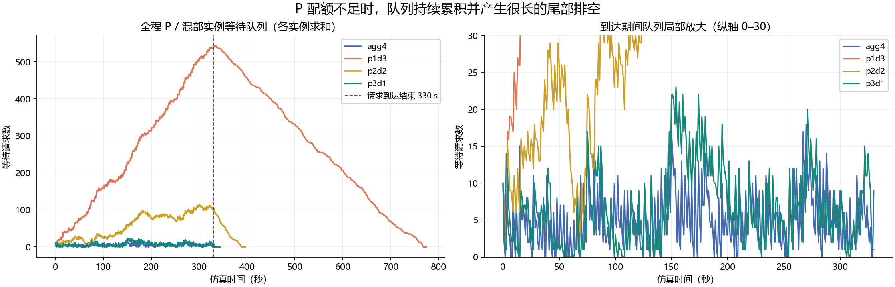

# DynoSim 静态部署首轮结果分析

日期：2026-10-21。

**四组均成功完成同一批 937 条请求。当前探索性 SLA 下，3P1D 的达标请求最多；1P3D、2P2D 的主要瓶颈是 P 侧准入排队；混部 agg4 的首 token 更快，但生成间隔尾部明显更差。** 这轮建立了静态部署的对照结果，还没有证明动态 P/D 快切的增益或可接受的切换时延。

原始结果目录：`/home/qingya/pd-sim/results/20261021T014523.636092Z_static`。分析依据为各 case 的 `resolved.yaml`、`run-metadata.json`、`runtime.json`、`analysis.json`、`prediction.json`、`requests.jsonl` 和 `telemetry.jsonl`。关键配置、统计及源文件 SHA256 保存在 [结果摘要](assets/dynosim-static-20261021/summary.json)。

## 1 实验条件与有效性

| 项目 | 本轮设置 |
|---|---|
| 运行参数 | `--suite static --max-requests 1000 --speedup 1` |
| 请求 | Mooncake FAST’25 Conversation 截取；边界时间戳分组扩展至 1001 条，再排除 64 条超上下文请求，得到 937 条 |
| 到达窗口 | 0–330 秒；111 个不同时间戳，有成组到达现象；从空缓存开始 |
| 请求规模 | 总输入 9,479,400 tokens；总输出 323,996 tokens；平均输入约 10,117、输出约 346 tokens |
| 模型与设备画像 | Qwen3-32B-FP8，H200 SXM；每实例 TP1、PP1、Attention DP1 |
| 性能刻画 | vLLM 0.24.0 查询槽位，op_level / SILICON，fallback deny |
| 软件 | aisimulate 0.13.0、ai-dynamo 1.6.0、ai-dynamo-runtime 1.6.0 |
| 调度 | Round Robin；agg / D 的 max_sequences=256；P 的 max_sequences=1；max_batched_tokens=8192 |
| KV | HBM 内缓存，开启 prefix reuse；KV FP8，page=64 tokens；trace hash block=512 tokens |
| PD 传输 | 131,072 bytes/token；50 GB/s；destination_missing；没有共享链路拥塞模型 |
| SLA | TTFT ≤ 5 秒，且请求平均 ITL ≤ 50 毫秒；为探索性阈值，尚非确认的业务 SLO |
| 动态机制 | 无扩缩容、无角色切换、无模型切换；startup=0 |

四组设备预算均为 4 张卡：

- **agg4**：4 个独立的单卡混部实例，每个实例承担自己请求的 Prefill 和 Decode；不是一个 TP4 实例。
- **p1d3**：1 个 P 实例和 3 个 D 实例。
- **p2d2**：2 个 P 实例和 2 个 D 实例。
- **p3d1**：3 个 P 实例和 1 个 D 实例。

有效性检查：四组 `valid=true`，全部 937 条请求完整输出，无输出长度不匹配、无缺失终态、无 readmission。trace SHA256、实验脚本 SHA256、软件版本和源码 HEAD 一致。不同运行的请求 UUID 不一致，但 `(arrival_time_ms, input_length, requested_output_length)` 在本批数据中逐条唯一且四组集合相同，可据此对齐请求。

本轮不能与之前 190 条请求的 agg1 结果直接比较部署优劣：请求数量和到达窗口均不同。Dynamo 工作区记录为 dirty，除 Git LFS 资源展开外涉及 Cargo 配置与 lock 文件；复现实验应保留当前构建配置和版本。

## 2 核心结果

| 指标 | agg4 | 1P3D | 2P2D | 3P1D |
|---|---:|---:|---:|---:|
| 完整完成请求 | 937 | 937 | 937 | 937 |
| SLA 达标请求 | 585 | 7 | 75 | **757** |
| SLA 达标率 | 62.4% | 0.7% | 8.0% | **80.8%** |
| 达标请求吞吐 req/s | 1.705 | 0.009 | 0.189 | **2.201** |
| 平均 TTFT 秒 | **1.93** | 219.38 | 24.01 | 3.10 |
| p99 TTFT 秒 | **7.45** | 436.04 | 61.14 | 12.12 |
| 请求平均 ITL 的均值 ms | 62.06 | **15.50** | 17.93 | 28.82 |
| 请求平均 ITL 的 p99 ms | 576.78 | **17.19** | 20.85 | 40.25 |
| 总输出吞吐 tokens/s | 944.25 | 418.56 | 817.57 | 942.00 |
| 最后一条请求完成时刻 秒 | 343.13 | 774.07 | 396.29 | 343.95 |
| 到达结束后的排空时间 秒 | 13.13 | 444.07 | 66.29 | 13.95 |
| Prefix token 复用比例 | 9.36% | 6.20% | 9.54% | 9.05% |

统计口径：

- 本表分位数使用 `analysis.json` 的等权请求统计与线性插值。原生摘要使用的分位数算法可能产生小幅数值差异。
- “请求平均 ITL”先计算每个请求的平均 token 间隔，再在请求之间求均值或 p99。它不是把所有 token 间隔放在一起求 p99。5 条仅输出 1 token 的请求不参与 ITL 分布，因此 ITL 样本量为 932。
- 达标吞吐 = 达标且完整完成的请求数 / 仿真持续时间；不是脚本在 CPU 上的运行速度。
- 当前 agg4 与 3P1D 基本跟上到达流，因此约 944 tokens/s 的接近结果主要受输入负载约束，不能当作两者的最大容量相同。

### 2.1 3P1D 的优势与代价

相对 agg4，3P1D 多完成 **172 条 SLA 达标请求**，达标率提高 **18.4 个百分点**，达标吞吐提升约 **29.1%**。平均端到端时延从 **19.48 秒降到 13.04 秒**。

它同时付出了首 token 代价：平均 TTFT 从 1.93 秒增加到 3.10 秒，p99 从 7.45 秒增加到 12.12 秒。因此，不能说 3P1D 在所有性能维度都优于混部。

逐条对齐后，268 条请求从 agg4 不达标变为 3P1D 达标，另有 96 条反向变化，净增加 172 条。对较长输出的改善更明显，例如输出 129–512 tokens 的 522 条请求，平均端到端时延由 20.27 秒降到 13.20 秒；输出 513–1024 tokens 的 187 条请求，由 31.92 秒降到 21.14 秒。

### 2.2 哪一项 SLA 没达到

| 请求分类 | agg4 | 1P3D | 2P2D | 3P1D |
|---|---:|---:|---:|---:|
| 两项均达标 | 585 | 7 | 75 | 757 |
| 仅 TTFT 超标 | 26 | 930 | 862 | 180 |
| 仅请求平均 ITL 超标 | 281 | 0 | 0 | 0 |
| 两项均超标 | 45 | 0 | 0 | 0 |

**混部当前主要损失在生成流畅度，PD 分离当前主要损失在首 token 等待。** 三个 PD 配比的所有多 token 请求，其平均 ITL 均低于 50 ms；但 3P1D 仍有 180 条 TTFT 超标，尚不能称为满足全部业务需求的配置。

## 3 排队与阶段时延揭示的瓶颈

图中为各实例等待请求数之和。右图将纵轴限制为 0–30，便于比较 agg4 与 3P1D；超出上界的 1P3D、2P2D 曲线请结合左图看。

### 3.1 1P3D 和 2P2D 的 P 侧服务能力跟不上到达流

| 0≤t<330 秒的点采样统计 | agg4 | 1P3D | 2P2D | 3P1D |
|---|---:|---:|---:|---:|
| P / 混部等待队列均值 | 5.09 | 264.24 | 58.12 | 6.68 |
| P / 混部等待队列峰值 | 18 | 540 | 113 | 23 |
| D 等待队列均值 | 同一混部队列 | 0.05 | 0.17 | 0.23 |
| D 等待队列峰值 | 同一混部队列 | 1 | 2 | 3 |

这些是每秒采样点的统计，不是事件级时间积分。路由器 pending 队列均为 0；大量等待发生在 worker scheduler 准入处。

请求级 TTFT 可按事件时间拆分如下，各列先对每条请求求时间差，再求均值，因而可以相加：

| 平均时延 ms | 1P3D | 2P2D | 3P1D |
|---|---:|---:|---:|
| 到达 → P 准入 | 218,507.78 | 23,154.16 | 2,211.20 |
| P 准入 → Prefill 完成并持有源 KV | 820.10 | 792.91 | 798.19 |
| 上述时刻 → D 准入 | 39.08 | 43.93 | 57.06 |
| D 准入 → 首 token | 15.62 | 18.08 | 28.92 |
| TTFT 合计 | 219,382.57 | 24,009.08 | 3,095.37 |

P 准入前等待分别占平均 TTFT 的 **99.60%、96.44%、71.44%**。因此这轮优先应该研究 P 侧的实例配额和调度设置，传输路径尚不是主要时延来源。

这里说的是 **P 侧请求服务能力不足**，不等于已经测得 GPU FLOPS 利用率饱和。P 的 `max_sequences=1` 是未调优的基线设置，会限制并发和批处理收益；“多给 P 几张卡”与“提升每个 P 的有效服务能力”都可能改善结果，必须分别实验。

### 3.2 agg4 的问题是生成尾时延及请求形状不均衡

混部实例需要在同一调度循环中执行 P 与 D。当前 replay 将两类计算耗时纳入同一时间线，因而 Prefill 工作会拉长 Decode token 的生成间隔。结果表现为 agg4 的请求平均 ITL p99 达 576.78 ms，而 3P1D 为 40.25 ms。这与混部干扰相符，但改善幅度仍取决于后文所述的混合 batch 近似。

Round Robin 使四个混部 worker 各分到 234 或 235 条请求，但请求数均衡并不代表工作量均衡：worker 2 收到约 259 万输入 tokens，worker 0 约 222 万，相差约 16.8%；worker 2 的平均请求 ITL 为 87.81 ms，其余三个约为 50.00、51.69、58.77 ms。后续可以把路由策略作为单独变量，检验部分尾延迟是否可由更好的放置策略降低。

### 3.3 3P1D 的 Decode 已有负载，但尚未明显排队

3P1D 的 D 请求平均 ITL 为 28.82 ms，明显高于另外两个 PD 配比；其 D 实例在到达期间的 active KV 占用均值约 **40.06%**，峰值约 **79.23%**，峰值时同时有 60 条运行请求。

这说明 D 并非“没干活”。连续批处理下，D 侧可以同时运行很多请求而没有长等待队列。不能仅凭 D waiting≈0 就认定 D 的硬件利用率很低。

四组均无 preemption 或 readmission；现有证据不支持把 HBM 容量不足判为这轮的主导瓶颈。`physical_cache_usage=100%` 还可能包括可回收的 inactive prefix blocks，必须结合 active KV、调度停顿和回收事件一起判断。

### 3.4 不能把 post-prefill wait 全当作 KV 传输

该字段为 `decode_admit_ms - source_held_ms`，包含 KV 交接、目标侧准备和调度安全点等等待；并非隔离出的纯 DMA 时间。3P1D 这一段平均 57.06 ms、p99 128.16 ms，远低于其 P 准入等待。

作为数量级参考，按全 prompt、131,072 bytes/token、50 GB/s 计算，平均字节传输时间约 26.52 ms。但实际模型使用 `destination_missing` 和 block 粒度的目标缓存状态，不能用这个全量估计逐条核验传输，也不能把两者的差直接命名为“网络开销”。当前导出字段不足以恢复每条请求的精确传输字节数和纯传输完成时间。

## 4 对 P/D 动态切换研究的意义

本轮说明：**固定 P/D 配额分配不合适，会产生很大的排队损失；将更多实例配置为 P，对这批工作负载有价值。** 这为动态配额管理提供了研究动机。

但“错误静态配比有损失”与“动态切换优于最佳静态配比”是两个不同的问题。按到达时间分成 30 秒窗口比较，3P1D 在所有窗口的 SLA 达标数都不低于另外两个 PD 配比。当前没有观察到一段时间适合 3P1D、另一段时间又适合 1P3D 的明确反转。

因此，**还无法从这轮给出 P↔D 切换应压到多少毫秒或多少秒的正收益门槛**。它也不能由 39–57 ms 的 post-prefill wait 推出来：KV 交接耗时和实例角色转换耗时是不同对象。

后续需要在相同总设备预算下比较：

1. 调优后的最佳静态部署。
2. 具有真实资源守恒、排空和状态连续性的零额外切换开销动态部署，测收益上限。
3. 加入角色初始化、排空策略、状态迁移和缓存恢复代价，扫描收益转负的位置。

不能直接拼接各时间窗口中表现最好的静态结果作为动态结果，因为排队、在途请求和缓存状态会跨窗口延续。Trace 结束后的 P 空闲、D 继续排空也需要单独处理，避免把有限回放的结束效应当作在线切换收益。

## 5 结论的适用边界

- **调度参数尚未调优。** PD 与混部的差异包含角色分离和不同调度约束的共同作用，不能全部归因于部署架构。
- **混合 batch 时延是近似。** 当前 Dynamo vLLM replay 路径分别估计 P、D 时间并合成同一 forward 的时间线，未完整使用融合 mixed GEMM 的性能刻画；agg4 相对 PD 的差距需要后续实测或更细模型校准。
- **请求形状会被归约。** 部分 forward 查询使用 batch 的平均上下文或 prefix 长度，不能保持 batch 内完整的长度分布；表外插值或解析估计也不等同于该 shape 的直接实测。
- **GPU 利用率尚无结论。** 活跃请求数、KV 占用和 provisioned GPU-hours 都不是计算利用率。这里定位的是请求流程和调度层面的瓶颈。
- **互联目前很简化。** 固定 50 GB/s 的 KV 传输不描述拓扑、共享带宽竞争及多级池化 I/O，不能据此判断未来存储池没有瓶颈。
- **样本与平台范围有限。** 当前是 937 条、330 秒到达窗口、空缓存起跑、4 个单卡 GPU 实例；不直接代表 256/384 张昇腾 950、每实例 8/16 卡的大模型部署，也不能将当前毫秒数直接作为 950 的设计指标。

## 6 下一轮实验顺序

保留这轮作为原始对照，优先逐项改变变量：

| 顺序 | 改变什么 | 观察什么 | 要回答的问题 |
|---|---|---|---|
| 1 | 各 PD 配比的 P max_sequences 从 1 扩至 4、8；先保持 token budget=8192 | P 队列、P 阶段耗时、TTFT、goodput | 当前损失中有多少来自 P 调度约束，而非实例数量本身？ |
| 2 | 在选出的配置上改变到达速率，例如 speedup=0.5、1、2、4 | 吞吐是否趋于上限、队列是否持续增长、ITL 是否越过 SLA | 各部署的负载承受范围和瓶颈迁移点在哪里？ |
| 3 | 延长 trace，并取输入/输出长度比例差异明显的窗口；统一冷启动或暖机口径 | 分阶段 P/D 压力、最优静态配比是否发生变化 | 是否存在值得用角色切换追随的负载变化？ |
| 4 | 独立比较路由策略与 prefix reuse 设置 | 工作量均衡、缓存复用与尾时延 | 混部或分离的损失，是否可先由调度改善？ |
| 5 | 建立守恒的动态角色状态机并扫描切换代价 | 相对最佳静态配置的 SLA goodput、切换损失与恢复时间 | 快切是否有净收益，允许的代价是多少？ |

**近期最值得先做的是第 1 项。** 如果 P 的并发设置一改，2P2D 就明显改善，那么后续的“快切价值”必须以调优后的静态配置为参照。否则容易把本可由调度参数解决的问题误判成架构收益。
